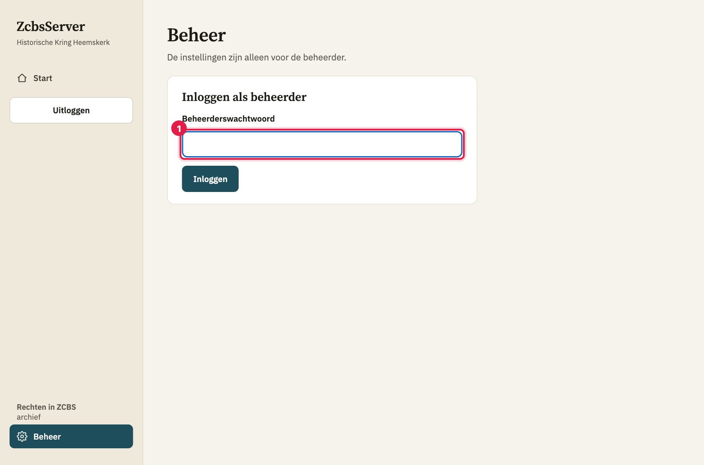
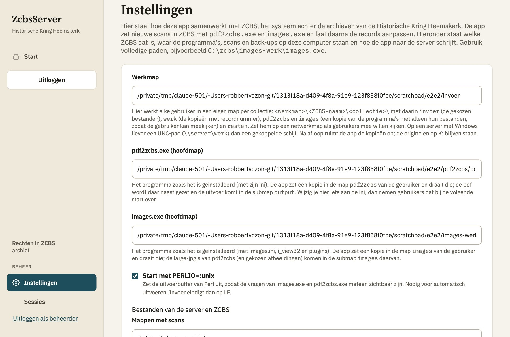
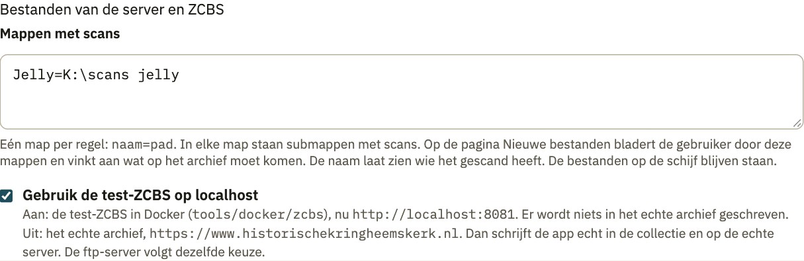
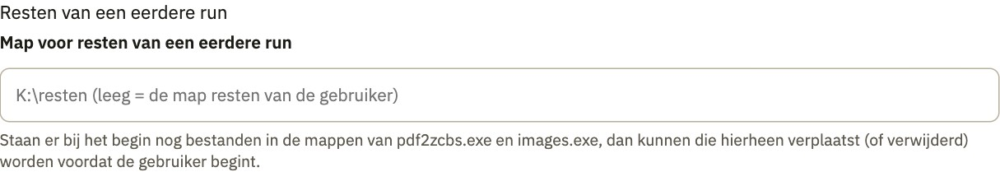
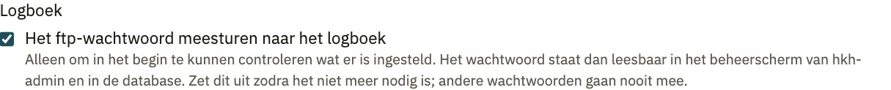
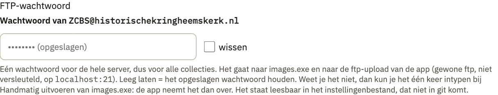
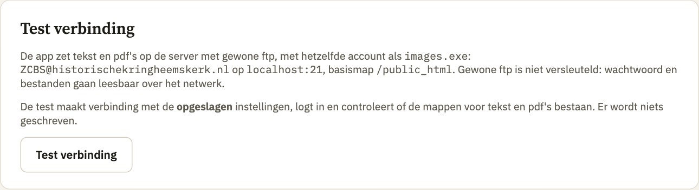
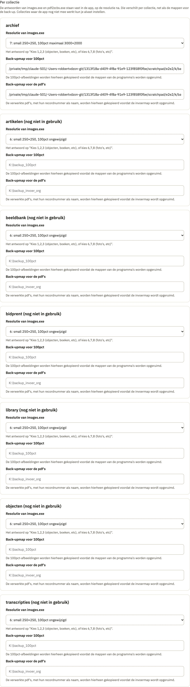
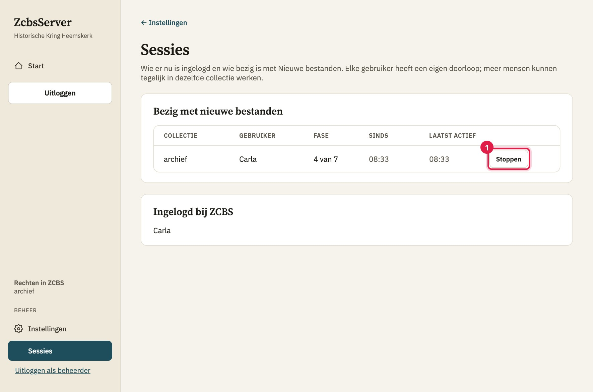

# Handleiding voor de beheerder: Instellingen

Deze handleiding beschrijft de pagina **Instellingen** van de hkh-workflow-app en de pagina's die erbij horen: **Beheer** (inloggen als beheerder), **Instellingen > Sessies** en de technische pagina **/test**. Ze is bedoeld voor de beheerder die de app op de server inricht en onderhoudt. Carla, Jelly en de andere gebruikers komen op deze pagina's niet.

De tekst is gebaseerd op de broncode van de app. Waar iets alleen uit de code is gelezen en nog niet is gecontroleerd op de echte HKH-server, staat dat erbij.

**Inhoud**

1. [Overzicht en toegang](#1-overzicht-en-toegang)
2. [Inloggen als beheerder](#2-inloggen-als-beheerder)
3. [Waar de instellingen worden bewaard](#3-waar-de-instellingen-worden-bewaard)
4. [Wat er bij Opslaan gebeurt](#4-wat-er-bij-opslaan-gebeurt)
5. [De velden van de pagina Instellingen](#5-de-velden-van-de-pagina-instellingen)
6. [De omgevingscontrole in fase 1 van Nieuwe bestanden](#6-de-omgevingscontrole-in-fase-1-van-nieuwe-bestanden)
7. [Systeeminstellingen buiten het scherm](#7-systeeminstellingen-buiten-het-scherm-applicationproperties-en-omgevingsvariabelen)
8. [Sessies](#8-sessies)
9. [De technische pagina /test](#9-de-technische-pagina-test)
10. [Meldingen aan het workflow-logboek](#10-meldingen-aan-het-workflow-logboek)
11. [Aanbevolen waarden: macOS-server of Windows](#11-aanbevolen-waarden-macos-server-of-windows)
12. [Tabel: veld naar waar gebruikt](#12-tabel-veld-naar-waar-gebruikt)
13. [Problemen en oplossingen](#13-problemen-en-oplossingen)
14. [Wat niet is bevestigd](#14-wat-niet-is-bevestigd)

---

## 1. Overzicht en toegang

De app is een wrapper rond ZCBS, het systeem achter de archieven van de Historische Kring Heemskerk. Hij zet gescande bestanden in ZCBS met `pdf2zcbs.exe` en `images.exe`, uploadt tekst en pdf's met ftp, maakt een back-up en laat daarna de records aanpassen. Op de pagina Instellingen staat hoe de app dat doet: welke ZCBS hij gebruikt, waar de programma's, scans en back-ups op de server staan en hoe hij naar de ftp-server schrijft.

| Pagina | Adres | Wie mag erheen |
|---|---|---|
| Beheer (inloggen als beheerder) | `/beheer` | iedereen kan de pagina openen; inloggen lukt alleen met het beheerderswachtwoord |
| Instellingen | `/instellingen` | alleen de beheerder |
| Ftp-verbinding testen | `/instellingen/ftp-test` (knop op de pagina Instellingen) | alleen de beheerder |
| Sessies | `/instellingen/sessies` | alleen de beheerder |
| Technische pagina Test | `/test` | alleen de beheerder (een deel van de onderliggende stappen ook voor een ingelogde ZCBS-gebruiker, zie hoofdstuk 9) |

Wie een pagina voor de beheerder opent zonder als beheerder ingelogd te zijn, wordt doorgestuurd naar `/beheer`. Na het inloggen komt hij terug op de pagina waar hij heen wilde.

Het menu links toont onderaan, onder het kopje **Beheer**, de links **Instellingen** en **Sessies** en de knop **Uitloggen als beheerder**, maar alleen als je als beheerder bent ingelogd. Anders staat er één link **Beheer**. Er is geen menu-item voor de pagina `/test`; die open je door het adres in te typen.

---

## 2. Inloggen als beheerder

De beheerder is een apart account van de ZCBS-gebruikers: er is één beheerderswachtwoord voor de hele app. Het staat niet in de instellingen of de database, maar in de configuratie van de server (zie hoofdstuk 7: `hkh.workflow.admin-password` of de omgevingsvariabele `HKH_WORKFLOW_ADMIN_PASSWORD`).

**Inloggen**

1. Kies in het menu **Beheer** (of ga naar `/beheer`).
2. Vul bij **Beheerderswachtwoord** het wachtwoord in en klik op **Inloggen**.
3. Je ziet nu "Je bent ingelogd als beheerder" met de knoppen **Instellingen** en **Uitloggen als beheerder**.

**Wat de app daarbij doet**

- Het ingevulde wachtwoord wordt vergeleken met het ingestelde wachtwoord via hun SHA-256-hashes, in constante tijd.
- Bij een goed wachtwoord wordt de sessie-id van de browser vernieuwd en wordt de browsersessie als beheerder gemarkeerd.
- Bij een fout wachtwoord wacht de app een seconde voordat hij antwoordt (dat remt het raden) en toont hij "Dat wachtwoord klopt niet."
- Is er in de configuratie helemaal geen wachtwoord ingesteld (leeg), dan toont de pagina "Er is geen beheerderswachtwoord ingesteld", is de knop **Inloggen** uitgeschakeld en kan niemand als beheerder inloggen. De instellingen blijven dan dicht.
- Na het inloggen stuurt de app je terug naar een pagina van de app zelf (standaard Instellingen). Adressen buiten de app worden niet gebruikt.

**Uitloggen** doe je met **Uitloggen als beheerder** in het menu. Je ziet dan weer de startpagina. De beheerderslogin staat los van de ZCBS-login: wie uitlogt bij ZCBS blijft beheerder zolang de browsersessie duurt, en omgekeerd.

**Belangrijk om te weten**

- De beheerderslogin geldt per browsersessie. Na een herstart van de app moet je opnieuw inloggen als beheerder (uit de code gelezen: de beheerdersmarkering staat alleen in de sessie).
- Beheerlogins worden niet gemeld aan het workflow-logboek; alleen ZCBS-logins worden gemeld (uit de code gelezen).
- De app start `.exe`-bestanden en luistert standaard op alle netwerkadressen. Zet de app alleen op een server waar niet iedereen bij kan, of laat hem alleen op de eigen computer luisteren met `HKH_WORKFLOW_ADDRESS=127.0.0.1`.

---

## 3. Waar de instellingen worden bewaard

- **Bestand:** `hkh-workflow-settings.json`, in JSON. De naam en plaats zijn te wijzigen met `hkh.workflow.settings-file` / `HKH_WORKFLOW_SETTINGS_FILE`. Een relatief pad geldt ten opzichte van de map waaruit de app wordt gestart (de volledige plek staat onderaan de pagina Instellingen: "Opgeslagen in ..."). Het bestand hoort niet in git.
- **Wachtwoord leesbaar:** het ftp-wachtwoord staat in dit bestand leesbaar. Geef het bestand dus alleen leesrechten voor het account waaronder de app draait en de beheerder.
- **Schrijven:** bij **Opslaan** schrijft de app eerst een tijdelijk bestand (zelfde naam met `.tmp` erachter) en verplaatst dat daarna over het echte bestand. Een onderbroken schrijfactie laat zo geen half bestand achter. Bestaat de map nog niet, dan maakt de app hem aan.
- **Eenmaal inlezen:** de app leest het bestand één keer en onthoudt de instellingen in het geheugen. Pas je het bestand met de hand aan, dan neemt de app dat pas over na een herstart (uit de code gelezen). Wijzig instellingen dus bij voorkeur via de pagina.
- **Bestand ontbreekt of is onleesbaar:** de app start dan met standaardwaarden (alle paden leeg, **test-ZCBS aan**, PERLIO aan, logboek-optie aan, resolutie 6). Bij een onleesbaar bestand staat er een waarschuwing in het applicatielog. Let op: als je daarna opslaat, overschrijf je het onleesbare bestand.
- **Afgeleide velden:** het bestand bevat ook `zcbsBaseUrl`, `ftpHost`, `ftpPort`, `ftpUser`, `ftpBaseDir` en `collection`. Die worden bij het inlezen altijd opnieuw bepaald uit de keuze "test-ZCBS" (zie 5.6). Handmatig aanpassen heeft dus geen effect.
- **Oudere bestanden:** een bestand van vóór de instellingen per collectie krijgt zijn back-upmappen en zijn resolutie bij het archief. Een bestand zonder de keuze voor de test-ZCBS telt als test, tenzij het oude adres het echte archief was. Zo wijst een oude instelling nooit ineens naar het echte archief. Een oud wachtwoord onder de naam `sftpPassword` of als oud antwoord op "FTP wachtwoord" wordt overgenomen.

Naast het instellingenbestand staan nog andere bestanden van de app (alleen ter oriëntatie):

| Bestand | Inhoud |
|---|---|
| `hkh-workflow-verwerkt.tsv` | het verwerkt-log (wat al op het archief is gezet); zonder pad komt het naast het instellingenbestand (`hkh.workflow.processed-log`) |
| `hkh-workflow-inloggen.key` | sleutel voor het "onthoud mijn login"-cookie van ZCBS-gebruikers; niet in git zetten |
| `logs/` | een logbestand per programma-run (`hkh.workflow.log-dir`) |

---

## 4. Wat er bij Opslaan gebeurt

Klik je op **Opslaan**, dan gebeurt dit in deze volgorde:

1. De app leest alle velden van het formulier. Alle zeven collecties van HKH hebben een eigen blok met resolutie en back-upmappen (zie 5.11); ze worden allemaal meegestuurd en opgeslagen, ook de collecties waar de app nog niet mee werkt.
2. De keuze voor de test-ZCBS bepaalt het adres van ZCBS en de ftp-server (zie 5.6); die worden opnieuw ingevuld.
3. De app **schoont op** (`SettingsService.save`):
   - de werkmap, het pad van `pdf2zcbs.exe`, het pad van `images.exe`, de map voor resten en de back-upmappen: spaties vooraan en achteraan worden weggehaald;
   - de mappen met scans: elke regel wordt getrimd en lege regels verdwijnen;
   - de resolutie: staat er iets anders dan 1, 2, 3, 6, 7 of 8, dan wordt het 6;
   - het ftp-wachtwoord wordt niet getrimd en niet gecontroleerd (zie 5.9).
4. De app schrijft het bestand (zie hoofdstuk 3) en onthoudt de nieuwe instellingen. Is er echt iets veranderd, dan meldt hij dat aan het workflow-logboek (hoofdstuk 10).
5. De pagina komt terug met "Instellingen opgeslagen."

**Opslaan wordt nooit geblokkeerd.** De app controleert niet of een map of programma bestaat voordat hij opslaat. Na het opslaan zie je onder de velden een rode of gele waarschuwing als iets ontbreekt of niet klopt (de tekst staat per veld in hoofdstuk 5). Een waarschuwing betekent dus niet dat opslaan mislukte, maar dat de app er later op vastloopt als je het niet herstelt.

Waarschuwingen op de pagina komen uit twee controles:

- de basiscontrole: bestaat de werkmap als map, bestaan `pdf2zcbs.exe` en `images.exe` als bestand en zijn ze uitvoerbaar;
- de extra controle: zijn de back-upmappen van het archief ingevuld en bestaan ze, zijn er mappen met scans ingesteld, is er een ftp-wachtwoord.

De waarschuwingen komen van het moment dat de pagina wordt geopend, dus van de computer waarop de app draait. Een K:-schijf die alleen op jouw pc is gekoppeld, telt niet mee.

---

## 5. De velden van de pagina Instellingen

De velden staan hieronder in de volgorde van het scherm. Bij elk veld staan: wat het is, welke waarden mogen, de standaardwaarde, wat de app controleert en wat er misgaat als het fout staat.

Schermvolgorde:

1. Werkmap
2. pdf2zcbs.exe (hoofdmap)
3. images.exe (hoofdmap)
4. Start met PERLIO=:unix
5. Groep **Bestanden van de server en ZCBS**: Mappen met scans; Gebruik de test-ZCBS op localhost
6. Groep **Resten van een eerdere run**: Map voor resten van een eerdere run
7. Groep **Logboek**: Het ftp-wachtwoord meesturen naar het logboek
8. Groep **FTP-wachtwoord**: Wachtwoord van ... (met **wissen**)
9. Groep **Per collectie**: Resolutie van images.exe; Back-upmap voor 100pct; Back-upmap voor de pdf's
10. De knop **Opslaan**, daaronder de sectie **Test verbinding**

Gebruik overal **volledige paden**, bijvoorbeeld `C:\zcbs\images-werk\images.exe`. Een relatief pad is niet bedoeld en kan naar de verkeerde plek wijzen.

### 5.1 Werkmap

| | |
|---|---|
| **Wat** | De map waarin elke gebruiker zijn eigen werkmappen heeft. Per gebruiker en per collectie maakt de app `<werkmap>\<ZCBS-naam>\<collectie>\` met de submappen `invoer` (de gekozen bestanden), `werk` (de kopieën met recordnummer), `pdf2zcbs` en `images` (een kopie van de programma's, zodat de gebruiker kan meekijken) en `resten`. In dezelfde map staat `sessie.json` met de stand van de doorloop. |
| **Voorbeeld** | `\\server\werkmap` of `C:\zcbs\werk` |
| **Mag** | Een bestaande map, bij voorkeur een netwerkmap als gebruikers mee willen kijken. Op een Windows-server die de app als service draait: een UNC-pad (`\\server\werkmap`) en geen gekoppelde schijf (zie hoofdstuk 11). |
| **Standaard** | Leeg (niet ingesteld) |
| **Controle bij opslaan** | Alleen opschonen (spaties weg). De pagina waarschuwt: leeg = "Nog niet ingevuld."; geen map = "Map bestaat niet." |
| **Controle in fase 1** | De omgevingscontrole kijkt hier niet direct naar. Wel zoekt hij in deze map naar resten van een eerdere keer (zie 6). Bij **Verder** op fase 1 maakt de app de mappen van de gebruiker aan; is de werkmap leeg of bestaat hij niet, dan stopt dat met "Stel eerst de werkmap in bij Instellingen." of "De werkmap bestaat niet: ...". De werkmap zelf maakt de app niet aan; de submappen wel. |
| **Fout** | Zonder werkmap kan niemand Nieuwe bestanden starten of bestanden kiezen. Staat de werkmap op een gekoppelde schijf die de service niet kent, dan werkt het lokaal wel maar niet als service. Een werkmap op een netwerkschijf die weg is, geeft dezelfde fout als een niet-bestaande map. Verandert de werkmap, dan zoekt de app de mappen en de bewaarde stand (`sessie.json`) op de nieuwe plek; wat in de oude werkmap staat, wordt niet meegenomen. |
| **Technisch** | De naam in het opslagbestand is `testFolder` (een erfenis van toen dit de testmap was). De naam van de gebruikersmap is de ZCBS-naam waarin tekens die op schijf niet mogen of lastig zijn, een `_` worden. De technische pagina /test werkt zonder ingelogde ZCBS-gebruiker in de map `gebruiker`. Bij het opstarten leest de app de bewaarde doorlopen terug uit `<werkmap>\<gebruiker>\<collectie>\sessie.json`. |

### 5.2 pdf2zcbs.exe (hoofdmap)

| | |
|---|---|
| **Wat** | Het volledige pad naar `pdf2zcbs.exe`, het programma zoals het is geïnstalleerd (met zijn `pdf2zcbs.ini`). De map waarin dit bestand staat is de **hoofdmap** van het programma. |
| **Hoe de app het gebruikt** | De app draait het programma niet vanuit de hoofdmap, maar vanuit een kopie in de map `pdf2zcbs` van de gebruiker. Bij het starten van de doorloop en vlak voor de stap kopieert de app wat ontbreekt of veranderd is (bestand ontbreekt, ander formaat of nieuwere wijzigingsdatum). Hij verwijdert nooit iets in de map van de gebruiker. Niet gekopieerd worden de gegevensmappen (`output`, `images`, `small`, `large`, `100pct`, `log`, `werk`, `invoer`), de bestanden met de extensie pdf, jpg, jpeg, png, tif of tiff en de logbestanden `log-*.txt`. De pdf wordt in de map van de gebruiker naast het programma gezet; de uitvoer komt in de submap `output`. |
| **Mag** | Het pad naar een bestaand, uitvoerbaar bestand. Op Mac/Linux mag het elk uitvoerbaar script zijn (met `chmod +x`). |
| **Standaard** | Leeg |
| **Controle bij opslaan** | Spaties weg. De pagina waarschuwt: leeg = "Nog niet ingevuld."; bestaat niet = "Bestand bestaat niet."; niet uitvoerbaar = "Bestand is niet uitvoerbaar (op Mac/Linux: chmod +x)." |
| **Controle in fase 1** | Regel "pdf2zcbs.exe en images.exe zijn gevonden": beide paden moeten een bestaand bestand zijn. Anders: "pdf2zcbs.exe of images.exe is niet gevonden", met de niet gevonden paden, of "(niet ingesteld)". |
| **Controle voor de stap** | De stap pdf2zcbs start niet bij een leeg pad ("Stel eerst het pad naar pdf2zcbs.exe in.") of een bestand dat er niet is ("pdf2zcbs.exe niet gevonden: ..."). |
| **Fout** | Een verkeerd pad: fase 1 blijft rood. Een wijziging in de ini van de hoofdmap nemen gebruikers bij de volgende start over. Staat de ini niet naast het programma, dan stelt pdf2zcbs vragen die de app anders niet krijgt; de app beantwoordt dan (automatisch) de vragen "Deze PDF splitsen" met n, "verwerken naar txt" met j, "(presentatie) slides" met n en het slotbericht met Enter. |

### 5.3 images.exe (hoofdmap)

| | |
|---|---|
| **Wat** | Het volledige pad naar `images.exe`, het programma zoals het is geïnstalleerd (met `images.ini`, `i_view32` en de plugins). Ook hier is de map de **hoofdmap**. |
| **Hoe de app het gebruikt** | Net als bij pdf2zcbs.exe draait de app een kopie in de map `images` van de gebruiker. De large-jpg's van pdf2zcbs (en gekozen afbeeldingen) komen in de submap `images` daarvan. Dezelfde regels gelden voor wat wel en niet gekopieerd wordt (zie 5.2). |
| **Mag / standaard** | Zoals bij 5.2; standaard leeg. |
| **Controle bij opslaan** | Zoals bij 5.2. |
| **Controle in fase 1** | Zoals bij 5.2 (dezelfde regel). |
| **Controle voor de stap** | "Stel eerst het pad naar images.exe in." of "images.exe niet gevonden: ...". |
| **Fout** | Zoals bij 5.2. Staat het ftp-wachtwoord niet in de instellingen, dan weigert **Automatisch uitvoeren** van images.exe (zie 5.9). |
| **Let op** | De echte `images.exe` heeft de ftp-server en de ftp-gebruiker zelf ingebouwd. Wat bij "test-ZCBS" is gekozen, bepaalt de ZCBS-verbinding en de ftp-upload van de app zelf, niet de verbinding van het programma `images.exe` (zie 5.6). |

### 5.4 Start met PERLIO=:unix

| | |
|---|---|
| **Wat** | Een aanvinkvakje. Aan: de app start `pdf2zcbs.exe` en `images.exe` met de omgevingsvariabele `PERLIO=:unix`. Daarmee buffert Perl zijn uitvoer niet, zodat de vragen van de programma's meteen zichtbaar zijn. |
| **Mag** | Aan of uit |
| **Standaard** | Aan |
| **Controle** | Geen. |
| **Wat de app daarmee doet** | Bij aan stuurt de app antwoorden af met alleen een regeleinde (LF). Bij uit, op Windows, met CR+LF. |
| **Fout** | Automatisch uitvoeren werkt alleen als de vragen zichtbaar zijn. Staat de optie uit en toont een programma zijn vragen pas laat, dan lijkt de app te blijven wachten. Zet hem dan weer aan. Volgens de projectdocumentatie is PERLIO niet nodig met de echte `images.exe` 3.27 op Windows (meting van 30 oktober 2026); de vraag verscheen daar zonder. |

### 5.5 Mappen met scans (groep "Bestanden van de server en ZCBS")

| | |
|---|---|
| **Wat** | De mappen waarin Jelly en Ria (of wie dan ook) hun scans zetten. Op de pagina Nieuwe bestanden (fase 2, Bestanden kiezen) bladert de gebruiker door deze mappen en vinkt aan wat op het archief moet komen. De naam laat zien wie het gescand heeft. De bestanden op de schijf blijven staan. |
| **Mag** | Eén map per regel, in de vorm `naam=pad`. Voorbeeld: `Jelly=K:\scans jelly` `Ria=K:\scans ria` |
| **Standaard** | Leeg |
| **Controle bij opslaan** | Elke regel wordt getrimd, lege regels verdwijnen. De app controleert het formaat niet bij het opslaan. |
| **Hoe de app de regels leest** | De naam is alles vóór het eerste `=`, het pad alles erna. Een regel zonder `=`, of met een lege naam of een leeg pad, telt niet mee (hij blijft wel in het veld staan). Bij twee mappen met dezelfde naam wordt de eerste gebruikt. |
| **Waarschuwing op de pagina** | "Nog niet ingevuld: zonder deze mappen kan niemand scans kiezen." (als er geen enkele geldige regel is) |
| **Controle in fase 1** | De regel "De mappen met scans zijn bereikbaar": er moet minstens één geldige regel zijn en elk pad moet een bestaande map zijn. Zo niet: "Er zijn geen mappen met scans ingesteld" (met "Dit stelt de beheerder in bij Instellingen."), of "De mappen met scans zijn niet bereikbaar" met de paden en de vraag of de schijf (K:) is gekoppeld. Zijn ze bereikbaar, dan toont de regel de namen (bijvoorbeeld Jelly, Ria). |
| **Fout** | Bladeren geeft "De map bestaat niet of is niet bereikbaar: ... Is de schijf gekoppeld?". De app laat alleen pdf's, jpg/jpeg en png zien; een png wordt bij het kiezen omgezet in een jpg. Het pad dat bij een verwerkt bestand wordt onthouden, is het pad van de map zelf. **Verander je later het pad van een map met scans** (bijvoorbeeld van een K:-letter naar een UNC-pad), dan herkent de app bestanden die al verwerkt zijn niet meer als "al verwerkt" in de lijst, omdat het verwerkt-log op het oude pad is bijgehouden (uit de code gelezen, niet bevestigd op de echte server). Overleg dan eerst. |

### 5.6 Gebruik de test-ZCBS op localhost

Dit is **de enige keuze voor de omgeving**. Hieruit volgen het adres van ZCBS en de ftp-server; die zijn niet apart in te stellen.

| | |
|---|---|
| **Wat** | Een aanvinkvakje. **Aan:** de app werkt met de test-ZCBS (de Docker-container uit `tools/docker/zcbs`, standaard `http://localhost:8081`; het adres staat op het scherm achter "nu"). Er wordt niets in het echte archief geschreven. **Uit:** de app werkt met het echte archief en schrijft echt in de collectie en naar de echte server. |
| **Standaard** | **Aan.** Een nieuwe installatie, een ontbrekend bestand of een onleesbaar bestand raakt het echte archief dus nooit per ongeluk. |
| **Wat eruit volgt** | |

| Keuze | ZCBS-adres (`zcbsBaseUrl`) | Ftp-server (`ftpHost:ftpPort`) | Ftp-gebruiker | Basismap |
|---|---|---|---|---|
| Aan (test) | `hkh.workflow.test-zcbs-url` (standaard `http://localhost:8081`) | `hkh.workflow.test-ftp-host` : `hkh.workflow.test-ftp-port` (standaard `localhost`:`21`) | vast: het account van images.exe | vast: `/public_html` |
| Uit (echt archief) | vast: het adres van de website van de Historische Kring Heemskerk | vast: de ftp-server van de Historische Kring, poort 21 | idem | idem |

Het scriptpad in ZCBS is steeds `/cgi-bin/<collectie>.pl` (voor het archief `/cgi-bin/archief.pl`).

| | |
|---|---|
| **Waar de test-ZCBS draait** | Op dezelfde computer als de app (`localhost`) of, op een andere computer, op het adres van de computer met de container. Dat stel je in met de systeeminstellingen `hkh.workflow.test-zcbs-url`, `test-ftp-host` en `test-ftp-port` (zie hoofdstuk 7). Draait de app niet op de computer met de container, laat die adressen dan niet op `localhost` staan. |
| **Wat verandert in de app** | Zodra de keuze wisselt, geldt de ZCBS-login niet meer: de app logt iedereen uit (hij ziet dat het ZCBS-adres is veranderd) en gebruikers moeten opnieuw inloggen. Bij het echte archief toont het menu in rood **Het echte archief**. Bij het echte archief schrijft elke opslag in ZCBS en gaat er een e-mail naar de beheerder (volgens de projectdocumentatie). |
| **Waarschuwing** | Zet dit vakje alleen uit als je zeker weet dat je in het echte archief wilt werken. Het vakje beïnvloedt alleen wat de app zelf doet (ZCBS-verbindingen en zijn eigen ftp-upload van tekst en pdf's). De echte `images.exe` heeft zijn eigen ftp-server ingebouwd (volgens de meting van 30 oktober 2026); op een gewone Windows-pc uploadt hij dus altijd naar de echte server, tenzij je die naam met een `hosts`-regel naar de test omleidt (zie `tools/windows-testlaptop/`). De tekst "Er wordt niets in het echte archief geschreven" op het scherm geldt dus voor de app zelf; voor `images.exe` alleen in een omgeving die is omgeleid. |
| **Controle** | Geen aparte controle. De ftp-controle in fase 1 en de knop **Test verbinding** gebruiken het gekozen adres. |
| **Fout** | Een verkeerd ingestelde `test-ftp-host` of `test-zcbs-url` geeft "Geen verbinding met ZCBS (adres): ..." bij het inloggen en "De ftp-server is niet bereikbaar" in fase 1. |

### 5.7 Map voor resten van een eerdere run (groep "Resten van een eerdere run")

| | |
|---|---|
| **Wat** | Staan er bij het begin van een doorloop nog bestanden van een eerdere keer (in de mappen van de gebruiker voor `invoer`, `werk`, `pdf2zcbs` of `images`), dan toont fase 1 dat als "Er staat nog werk van een eerdere keer". De gebruiker kan ze dan **verplaatsen** of **verwijderen**. Verplaatsen gaat naar deze map. |
| **Voorbeeld** | `K:\resten` of `\\server\resten` |
| **Mag** | Een map. Leeg laten betekent: de map `resten` in de mappen van de gebruiker (`<werkmap>\<gebruiker>\<collectie>\resten`). |
| **Standaard** | Leeg |
| **Wat de app doet** | Bij verplaatsen maakt de app onder deze map een submap per gebruiker en collectie en daaronder een submap met datum en tijd (`jjjjmmdd-uummss`), met de oorspronkelijke mapindeling. Voor het verplaatsen of verwijderen controleert de app of er een doorloop of programma bezig is; dan weigert hij. Hij raakt alleen de bestanden aan die in de lijst met resten staan en weigert iets buiten de map van het programma aan te raken. Daarna verwijdert hij lege mappen. |
| **Controle bij opslaan** | Alleen opschonen (spaties weg). Er is geen waarschuwing op de pagina en ook geen controle in fase 1: de map wordt pas gebruikt als iemand op **Verplaatsen** klikt. |
| **Fout** | Een pad dat niet bestaat of niet schrijfbaar is: de app maakt de mappen aan zodra hij kan; lukt het niet dan meldt hij "Opruimen is niet helemaal gelukt: ..." Controleer dan de mappen van de programma's. Is werkmap én resten-map leeg, dan staat er "Stel eerst de invoermap of de map voor resten in bij Instellingen." |

### 5.8 Het ftp-wachtwoord meesturen naar het logboek (groep "Logboek")

| | |
|---|---|
| **Wat** | Een aanvinkvakje. Aan: bij elke melding aan het workflow-logboek van hkh-admin (instellingenwijzigingen en doorlopen) staat het ftp-wachtwoord leesbaar in de gemelde instellingen. |
| **Waarom** | Alleen om in het begin te kunnen controleren wat er is ingesteld. Het wachtwoord staat dan leesbaar in het beheerscherm van hkh-admin en in de database daarvan. Andere wachtwoorden gaan nooit mee. |
| **Standaard** | **Aan** (zo staat het in een nieuwe installatie). **Zet dit uit zodra het niet meer nodig is.** |
| **Controle** | Geen. De optie heeft alleen effect als het workflow-logboek aan staat (`hkh.workflow.admin-log-url` niet leeg, zie hoofdstuk 7). |
| **Fout / let op** | Staat de optie aan, dan is het wachtwoord leesbaar voor iedereen die bij dat beheerscherm kan. Dat een wachtwoord veranderde, staat er altijd bij, ook als het wachtwoord zelf is weggelaten. Alleen de nieuwe stand van de optie telt: zet je de optie uit en wijzig je in dezelfde keer het wachtwoord, dan wordt het nieuwe wachtwoord niet meegestuurd. |

### 5.9 Wachtwoord van ... (groep "FTP-wachtwoord")

De naam van het account staat in het label: het ftp-account van images.exe. Het is niet instelbaar.

| | |
|---|---|
| **Wat** | Het wachtwoord van het ftp-account van images.exe. **Eén wachtwoord voor de hele server**, dus voor alle collecties. Het gaat naar `images.exe` (als antwoord op "FTP wachtwoord") en naar de ftp-upload van de app. Het is gewone ftp: niet versleuteld, het wachtwoord en de bestanden gaan leesbaar over het netwerk. De server en poort staan in de tekst onder het veld en volgen uit de keuze voor de test-ZCBS. |
| **Mag** | Elke tekst; spaties worden niet weggehaald. |
| **Standaard** | Leeg (niet ingesteld) |
| **Leeg laten** | **Leeg laten betekent: het opgeslagen wachtwoord houden.** Het veld toont "•••••••• (opgeslagen)" als er een wachtwoord is. De app toont het wachtwoord nooit. |
| **Wissen** | Het vakje **wissen** (alleen zichtbaar als er een wachtwoord is opgeslagen) verwijdert het wachtwoord. Vink je **wissen** aan én vul je een nieuw wachtwoord in, dan wint **wissen**: het wachtwoord wordt leeg. Wil je vervangen, vul dan alleen het nieuwe wachtwoord in. |
| **Zelf overnemen** | Is het wachtwoord nog leeg, dan kan de gebruiker het één keer intypen bij **Handmatig uitvoeren** van images.exe (op de vraag "FTP wachtwoord"). Als die stap goed afloopt, neemt de app het over als instelling. Hij doet dat alleen als er nog geen wachtwoord stond. Dit wordt als wijziging gemeld met als reden "Het FTP-wachtwoord is overgenomen van het handmatig uitvoeren van images.exe". |
| **Waarschuwing op de pagina** | "Nog niet ingevuld. Vul het hier in, of typ het één keer in bij Handmatig uitvoeren van images.exe: dan neemt de app het over." |
| **Controle in fase 1** | Valt onder de regel "De ftp-gegevens voor de upload zijn niet ingesteld" (zie hoofdstuk 6). |
| **Fout** | Zonder wachtwoord: fase 1 blijft rood bij de ftp-regel; **Automatisch uitvoeren** van images.exe weigert ("Voor automatisch uitvoeren moet bij Instellingen het FTP-wachtwoord staan. Gebruik anders Handmatig uitvoeren ..."); de upload-stap meldt "Ftp-wachtwoord is niet ingesteld". Een fout wachtwoord: "inloggen is mislukt: ..." bij Test verbinding en in fase 1. Het wachtwoord staat leesbaar in het instellingenbestand (zie hoofdstuk 3). |
| **Let op** | Enkele meldingen in de app verwijzen nog naar "de antwoorden voor images.exe" in de instellingen. Die sectie bestaat niet meer; het wachtwoord staat in de groep **FTP-wachtwoord**. |

### 5.10 Test verbinding

Onder het formulier staat de sectie **Test verbinding**. Ze toont het account, de ftp-server met poort (uit de keuze voor de test-ZCBS) en de basismap. De knop **Test verbinding**:

- gebruikt de **opgeslagen** instellingen, niet wat je net hebt getypt maar nog niet hebt opgeslagen. Sla dus eerst op;
- logt in op de ftp-server en controleert of de mappen voor tekst (`/public_html/archief/ocr`) en voor pdf's (`/public_html/archief/pdf`) bestaan;
- schrijft **niets** naar de server en maakt geen mappen aan.

Het resultaat toont "Verbonden met ... als ..." en per map "bestaat" of "bestaat niet". Voordat hij verbindt controleert de app of host, gebruiker, wachtwoord en collectie zijn ingevuld; zo niet, dan krijg je een lijst met wat ontbreekt. De wachttijd om te verbinden is 15 seconden (in fase 1 vijf).

Bij het uploaden zelf werkt de app voorzichtig: hij overschrijft nooit een bestaand bestand, verwijdert nooit iets op de server en maakt nooit mappen aan. Hij controleert eerst of alle doelmappen bestaan en of geen enkel doelbestand al bestaat, uploadt onder een tijdelijke naam, hernoemt en controleert de grootte.

### 5.11 Per collectie

Bovenaan de groep staat: "De antwoorden van images.exe en pdf2zcbs.exe staan vast in de app, op de resolutie na. Die verschilt per collectie, net als de mappen voor de back-up. Collecties waar de app nog niet mee werkt kun je alvast instellen."

Er is een blok voor elk van de zeven collecties van HKH: archief, artikelen, beeldbank, bidprent, library, objecten, transcripties. Alleen het **archief** is nu in gebruik; de andere hebben de toevoeging "(nog niet in gebruik)". De waarden van de andere collecties worden wel opgeslagen, maar nergens gebruikt en niet gecontroleerd.

**Alle antwoorden die de app voor `images.exe` geeft zijn vast** (uit de code, `ExeAnswers`). Alleen de resolutie en het ftp-wachtwoord komen uit de instellingen. Wat vast staat: bestandstype `a`, instelling `4`, uploaden `j`, records aanmaken `j`, tijdelijk PC-bestand verwijderen `j`, en altijd **nee** op "OVERSCHRIJVEN", op "VERWIJDEREN (tijdelijk) aangemaakte mappen" en op "VERWIJDEREN inhoud van de map [images]" (ook als iemand zelf iets anders typt). Het antwoord op "Kies de ZCBS-toepassing" is de collectie (nu archief). Een vraag die de app niet kent (bijvoorbeeld een andere versie van het programma) beantwoordt hij niet: hij stopt en toont de vraag.

#### Resolutie van images.exe

| | |
|---|---|
| **Wat** | Het antwoord op de vraag van images.exe "Kies 1,2,3 (objecten, boeken, etc), of kies 6,7,8 (foto's, etc)". Het bepaalt de afmetingen van de afgeleide afbeeldingen. |
| **Mag** | Een keuzelijst met zes opties: 1: small 100×100, 100pct ongewijzigd 2: small 100×100, 100pct maximaal 3000×2000 3: small 100×100, 100pct maximaal 4000×3000 6: small 250×250, 100pct ongewijzigd 7: small 250×250, 100pct maximaal 3000×2000 8: small 250×250, 100pct maximaal 4000×3000 Het eerste cijfer is de grootte van de small (1 t/m 3 voor objecten en boeken, 6 t/m 8 voor foto's), het tweede bepaalt de 100pct. |
| **Standaard** | **6** (ook voor het archief) |
| **Controle bij opslaan** | Staat er iets anders dan 1, 2, 3, 6, 7 of 8 (bijvoorbeeld in een handmatig bewerkt bestand), dan wordt het 6. |
| **Controle in fase 1** | Geen. |
| **Fout** | Een verkeerde keuze geeft afbeeldingen van de verkeerde afmeting; de pagina merkt dat niet. Controleer na een wijziging de eerste uitvoer van images.exe (de stap toont de afmetingen van de gemaakte bestanden). |

#### Back-upmap voor 100pct

| | |
|---|---|
| **Wat** | De map waarheen de 100pct-afbeeldingen worden gekopieerd voordat de app de mappen van de programma's opruimt (stap 7, Back-up). De bestanden heten `<recordnummer>.jpg`. |
| **Voorbeeld** | `K:\backup_100pct` |
| **Mag** | Een bestaande map. Per collectie een eigen map. |
| **Standaard** | Leeg |
| **Controle bij opslaan** | Spaties weg. De pagina waarschuwt (alleen voor het archief): leeg = "Nog niet ingevuld."; geen map = "Map bestaat niet." |
| **Controle in fase 1** | Regel "De back-upmappen zijn bereikbaar": beide back-upmappen (100pct en pdf) moeten bestaande mappen zijn. Zo niet: "De back-upmappen zijn niet bereikbaar" met de paden (of "(niet ingesteld)") en de vraag of K: is gekoppeld. |
| **Controle voor de stap** | De stap Back-up start niet bij een lege of niet-bestaande map ("Stel eerst de back-upmap voor de 100pct in" / "Back-upmap voor de 100pct bestaat niet: ..."). |
| **Wat de app doet** | De app kopieert eerst en controleert dat het resultaat even groot is als het origineel; pas daarna ruimt hij op. Staat hetzelfde bestand er al (opnieuw proberen), dan gebeurt er niets. Staat er een ander bestand met dezelfde naam, dan krijgt de kopie een volgnummer (`-1`, `-2`, ...) in plaats van te overschrijven. Is de kopie niet even groot, dan blijft alles staan: "Back-up van ... is niet even groot als het origineel; er is niets verwijderd." |
| **Fout** | Zonder bereikbare back-upmap start de back-upstap niet en blijft de doorloop voor die stap staan. De bestanden in de programmamappen blijven dan intact. |

#### Back-upmap voor de pdf's

| | |
|---|---|
| **Wat** | De map waarheen de verwerkte pdf's, met hun recordnummer als naam (`<recordnummer>.pdf`), worden gekopieerd voordat de invoermap wordt opgeruimd. Vervangt de vroegere back-up van de invoer (`backup_invoer_org`). |
| **Voorbeeld** | `K:\backup_invoer_org` |
| **Mag, standaard, bij opslaan** | Zoals bij de back-upmap voor 100pct. |
| **Controle in fase 1** | Dezelfde regel als hierboven: de back-upmappen zijn bereikbaar. |
| **Controle voor de stap** | Alleen als er pdf's in de batch zitten (bij alleen afbeeldingen is er geen pdf-back-up nodig): "Stel eerst de back-upmap voor de pdf's in" / "Back-upmap voor de pdf's bestaat niet: ...". |
| **Fout** | Zoals bij de back-upmap voor 100pct. Let op: de pagina en fase 1 eisen beide mappen, ook al worden bij een batch met alleen afbeeldingen alleen de 100pct gebruikt. |

### 5.12 Wat niet op het scherm staat (vast of afgeleid)

| Onderwerp | Waarde |
|---|---|
| Collectie | altijd `archief` (niet instelbaar) |
| Ftp-gebruiker | altijd het ftp-account van images.exe |
| Ftp-basismap | altijd `/public_html` |
| Ftp-mappen | altijd `<basismap>/<collectie>/ocr` (tekst) en `<basismap>/<collectie>/pdf` (pdf's) |
| Ftp-host en -poort | volgen uit de keuze "test-ZCBS" (zie 5.6) |
| ZCBS-adres | volgt uit de keuze "test-ZCBS" |
| Antwoorden op de vragen van images.exe en pdf2zcbs.exe | vast in de code, op de resolutie en het ftp-wachtwoord na |
| Welke collecties de app gebruikt | alleen het archief. De andere collecties staan op de keuzepagina uit, ook als de gebruiker er rechten heeft |

---

## 6. De omgevingscontrole in fase 1 van Nieuwe bestanden

Als Carla of Jelly op de pagina Nieuwe bestanden begint, toont de app in fase 1 (**Controleren**) een lijst met vinkjes. Pas als alles groen is, mag de gebruiker verder. Wat niet klopt, krijgt een uitleg; de app wijst waar nodig naar de beheerder ("Dit stelt de beheerder in bij Instellingen."). De controles staan in `FlowSession.environment()`. Er zijn zeven regels:

| # | Regel (groen) | Rood als... | Hangt af van instelling |
|---|---|---|---|
| 1 | Ingelogd bij ZCBS als ... | de gebruiker niet is ingelogd bij ZCBS ("Log eerst in via Start.") | keuze test-ZCBS (het adres) |
| 2 | ZCBS geeft de vrije recordnummers | de lijst met vrije nummers niet op te halen is (sessie verlopen, of geen recht om records aan te maken) | keuze test-ZCBS |
| 3 | De mappen met scans zijn bereikbaar | er geen mappen zijn ingesteld, of een van de paden geen bestaande map is | **Mappen met scans** |
| 4 | pdf2zcbs.exe en images.exe zijn gevonden | een van de twee paden leeg is of geen bestaand bestand | **pdf2zcbs.exe (hoofdmap)**, **images.exe (hoofdmap)** |
| 5 | De back-upmappen zijn bereikbaar | een van de twee back-upmappen van het archief leeg is of niet bestaat | **Back-upmap voor 100pct**, **Back-upmap voor de pdf's** |
| 6 | De ftp-server is bereikbaar en de mappen voor tekst en pdf bestaan | zie hieronder | **ftp-wachtwoord**, keuze test-ZCBS (host en poort) |
| 7 | Er staat geen werk van een eerdere keer | er nog bestanden staan in `invoer`, `werk` of de programmamappen van deze gebruiker | **Werkmap**, (voor het verplaatsen:) **Map voor resten van een eerdere run** |

De ftp-regel (6) heeft drie uitkomsten:

1. **"De ftp-gegevens voor de upload zijn niet ingesteld"**: host, gebruiker of wachtwoord ontbreekt. In de praktijk ontbreekt het wachtwoord, want host en gebruiker zijn altijd gevuld.
2. **"De ftp-server is niet bereikbaar"**: de app probeerde in te loggen (vijf seconden wachttijd) en dat lukte niet; de reden uit de ftp-server staat erbij (verkeerd wachtwoord, geen verbinding).
3. **"Op de ftp-server ontbreken mappen"**: verbinding en login lukken, maar `<basismap>/archief/ocr` of `<basismap>/archief/pdf` bestaat niet. De app maakt nooit zelf mappen op de server aan; laat ze door de hostingbeheerder aanmaken (of controleer of de juiste omgeving is gekozen).

Bij **Verder** voert de app de controle opnieuw uit. Is er één regel rood, dan meldt hij de eerste rode regel met de uitleg. Is alles groen, dan maakt hij de mappen van de gebruiker aan (werkmap moet bestaan), kopieert hij de programma's uit de hoofdmappen (zie 5.2) en begint de doorloop.

Daarna controleert de app nog per stap wat nodig is (bijvoorbeeld bestaat het programma, zijn er geen vreemde pdf's in de map van pdf2zcbs, staat het ftp-wachtwoord erin, bestaan de back-upmappen). Die meldingen staan als lijst bij de stap en houden de knop uit zolang het probleem er is. Ze verwijzen naar dezelfde velden als hierboven.

---

## 7. Systeeminstellingen buiten het scherm (application.properties en omgevingsvariabelen)

Een aantal instellingen staat niet op de pagina Instellingen maar in de configuratie van de server. Je zet ze in `application.properties` naast de jar of als omgevingsvariabele. Wijzigingen werken pas na een herstart van de app.

| Eigenschap | Omgevingsvariabele | Standaard | Betekenis |
|---|---|---|---|
| `server.address` | `HKH_WORKFLOW_ADDRESS` | `0.0.0.0` | Op welk adres de app luistert. `127.0.0.1` = alleen de eigen computer. |
| `server.port` | `HKH_WORKFLOW_PORT` | `9000` | De poort van de app. |
| `hkh.workflow.settings-file` | `HKH_WORKFLOW_SETTINGS_FILE` | `hkh-workflow-settings.json` | Het instellingenbestand (hoofdstuk 3). |
| `hkh.workflow.processed-log` | `HKH_WORKFLOW_PROCESSED_LOG` | `hkh-workflow-verwerkt.tsv` | Het verwerkt-log; zonder pad naast het instellingenbestand. |
| `hkh.workflow.console-charset` | `HKH_WORKFLOW_CONSOLE_CHARSET` | `IBM850` | Codepagina van de DOS-uitvoer van de exe's (Nederlandse Windows). |
| `hkh.workflow.log-dir` | `HKH_WORKFLOW_LOG_DIR` | `logs` | Waar de logbestanden van de programma-runs komen (per collectie en gebruiker een submap). |
| `hkh.workflow.admin-password` | `HKH_WORKFLOW_ADMIN_PASSWORD` | leeg in de code | Het beheerderswachtwoord. Leeg = niemand kan als beheerder inloggen, dus de instellingen zijn dicht. |
| `hkh.workflow.admin-log-url` | `HKH_WORKFLOW_ADMIN_LOG_URL` | het adres van het workflow-logboek van hkh-admin | Waarheen de meldingen gaan. Leeg = niets melden. |
| `hkh.workflow.test-zcbs-url` | (geen vaste naam in application.properties) | `http://localhost:8081` | Adres van de test-ZCBS als de test-keuze aan staat (zie 5.6). |
| `hkh.workflow.test-ftp-host` | idem | `localhost` | Ftp-server van de test-ZCBS. |
| `hkh.workflow.test-ftp-port` | idem | `21` | Poort van die ftp-server. |
| `hkh.workflow.session-timeout-minutes` | `HKH_WORKFLOW_SESSION_TIMEOUT_MINUTES` | `120` | **Heeft geen werking meer**, zie hieronder. |

**Het beheerderswachtwoord**

- De meegeleverde `application.properties` in de jar bevat een voorbeeldwaarde voor `hkh.workflow.admin-password`. Gebruik die niet in productie: zet een eigen wachtwoord in de omgevingsvariabele `HKH_WORKFLOW_ADMIN_PASSWORD` of in een `application.properties` naast de jar. Dat wachtwoord gaat dan voor (standaardgedrag van Spring Boot, niet apart op de HKH-server gecontroleerd).
- Noteer het wachtwoord niet in de documentatie of in git.
- Bij een leeg wachtwoord is niemand beheerder. De pagina `/beheer` vertelt dat.

**De test-ZCBS-adressen** staan niet in de meegeleverde `application.properties`. Zet ze in een `application.properties` naast de jar (`hkh.workflow.test-zcbs-url=...`). Als omgevingsvariabele werkt de standaardomzetting van Spring Boot (`HKH_WORKFLOW_TEST_ZCBS_URL`, `HKH_WORKFLOW_TEST_FTP_HOST`, `HKH_WORKFLOW_TEST_FTP_PORT`); die schrijfwijze is niet apart op de server uitgeprobeerd.

**Het workflow-logboek** (`admin-log-url`): zie hoofdstuk 10. De meldingen gaan op een eigen draad; een traag of onbereikbaar logboek houdt de app nooit op. Een leeg adres betekent dat er niets wordt gemeld (zo staat het in de code en de README). Of een lege omgevingsvariabele de standaardwaarde ook echt vervangt, is niet uitgeprobeerd; zet het leeg maken bij voorkeur in `application.properties`.

**Sessietimeout:** `hkh.workflow.session-timeout-minutes` staat nog in `application.properties` en in de README ("Na zoveel minuten zonder activiteit komt een in gebruik zijnde collectie vrij"). In de huidige code wordt deze eigenschap door niets meer gelezen (er is geen slot per collectie meer). Instellen heeft dus geen effect; een doorloop blijft staan tot de gebruiker hem afrondt of de beheerder hem stopt (hoofdstuk 8).

---

## 8. Sessies

Open **Instellingen > Sessies** (menu: **Sessies**, onder **Instellingen**; adres `/instellingen/sessies`). De pagina heeft een link **← Instellingen** terug.

**Er is geen slot per collectie.** Elke gebruiker heeft een eigen doorloop van Nieuwe bestanden, met eigen mappen en een eigen kopie van de programma's. Meer mensen kunnen tegelijk werken, ook in dezelfde collectie. Het enige dat ze kunnen delen zijn de recordnummers. Daarom controleert de app vlak voor `images.exe` nog eens of de nummers vrij zijn in ZCBS en meldt hij het als iemand anders ze intussen gebruikte (dan begint de gebruiker opnieuw met een ander beginnummer).

De pagina toont twee blokken.

**Bezig met nieuwe bestanden**: een tabel met een regel per doorloop waar iemand mee bezig is. Een doorloop telt mee zodra de gebruiker in fase 1 op **Verder** heeft gedrukt (of er een doorloop loopt). Nog niet gestarte doorlopen staan er niet in.

| Kolom | Betekenis |
|---|---|
| Collectie | de collectie (nu archief) |
| Gebruiker | de ZCBS-naam; "(beheerder)" als de doorloop vanaf de technische pagina is gestart zonder ZCBS-gebruiker |
| Fase | de huidige fase, "x van 7" |
| Sinds | tijdstip (uren:minuten) waarop de doorloop begon |
| Laatst actief | tijdstip van de laatste handeling van de gebruiker |
| (knop) | **Stoppen** |

Staat er niemand: "Er werkt nu niemand aan nieuwe bestanden."

**Ingelogd bij ZCBS**: de namen van wie nu bij ZCBS is ingelogd (bijvoorbeeld "Carla, Jelly"), of "Niemand." Na een herstart van de app zijn de ZCBS-logins weg; gebruikers met een "onthoud mijn login"-cookie worden bij hun volgende verzoek automatisch weer ingelogd.

**Een doorloop stoppen**

1. Klik op **Stoppen** bij de regel en bevestig de vraag "Deze doorloop stoppen? Wat de gebruiker hier doet wordt gestopt en hij moet opnieuw beginnen."
2. De app stopt een lopend programma van die gebruiker en wist de stand van de doorloop. Is de doorloop nog niet met de stappen begonnen (alleen bestanden gekozen), dan verwijdert hij ook de kopieën die de app zelf in de invoermap heeft gezet; de originelen op de scanschijf blijven altijd staan.
3. Je ziet "De doorloop is gestopt." Was de doorloop er al niet meer: "Deze doorloop was er al niet meer."

Wat blijft staan: bestanden in de mappen van de gebruiker (bijvoorbeeld de kopieën met recordnummer, de pdf's in de map van pdf2zcbs, resultaten van images.exe) en wat al naar de ftp-server is gegaan. Begint de gebruiker opnieuw, dan toont fase 1 dat als "Er staat nog werk van een eerdere keer", met de keuze verplaatsen of verwijderen (zie 5.7). Kijk daarom eerst naar de kolom Fase voordat je stopt. Was er al iets geüpload of waren de records al aangemaakt, dan staat dat op de server; de app overschrijft nooit en verwijdert nooit iets op de ftp-server.

De stand van een doorloop wordt elke vijf seconden bewaard in `sessie.json` in de map van de gebruiker en bij het opstarten van de app teruggezet, dus een herstart van de app (of van de service) verliest geen doorlopen.

---

## 9. De technische pagina /test

De pagina `/test` is de technische weergave voor de beheerder: je verwerkt de pdf's in de invoermap stap voor stap (hernoemen, `pdf2zcbs.exe`, `images.exe`, upload, back-up en opruimen), met alle knoppen, de console en de logbestanden. Carla gebruikt hiervoor de pagina Nieuwe bestanden. Er is geen link in het menu; open `/test` met het adres.

- **Toegang:** `/test` zelf en de onderdelen `/test/runs/...`, `/test/start` en `/test/reset` vragen de beheerder. De overige onderdelen (de console, het volledige log, een stap uitvoeren, overslaan, op klaar zetten of opnieuw proberen) werken ook voor een ingelogde ZCBS-gebruiker, omdat de pagina Nieuwe bestanden ze gebruikt.
- **Bovenaan** staat, als er iets niet klopt, "Niet alles is ingesteld:" met de waarschuwingen van de pagina Instellingen (hoofdstuk 4) en een link naar Instellingen.
- **Nieuwe test starten:** toont de invoermap en de gekozen bestanden. Je vult het **Eerste volgnummer** in; elk bestand krijgt een volgnummer (steeds één hoger, voorloopnullen blijven staan). **De pagina controleert niet of de nummers vrij zijn in ZCBS**; dat doet de pagina Nieuwe bestanden. Gebruik /test dus alleen voor testen of als je zeker weet dat de nummers vrij zijn.
- **Per stap:** **Uitvoeren** voor de interne stappen; voor de programma's **Handmatig uitvoeren** (jij beantwoordt de vragen), **Automatisch uitvoeren** (de app geeft de vaste antwoorden) en **In cmd-venster op de server** (alleen als de app op Windows draait; opent het programma in een eigen venster). Verder zie je de console, **Volledig log**, en onderaan **Runs** met alle logbestanden (**Toon** en **Wis**, en **Alle logs wissen**; het log van een lopend programma blijft staan).
- **Nieuwe test:** stopt een nog lopend programma en maakt de console leeg.

De instellingen die de technische pagina gebruikt zijn dezelfde als op de pagina Instellingen; er zijn geen aparte instellingen.

---

## 10. Meldingen aan het workflow-logboek

De app meldt (als `hkh.workflow.admin-log-url` is ingevuld) aan het workflow-logboek van hkh-admin:

- elke ZCBS-inlogpoging;
- de stand van elke doorloop (alle instellingen zonder wachtwoorden, de gekozen bestanden, stappen en de uitvoer van de programma's);
- **elke wijziging van de instellingen** (`SettingsChangeReporter`).

**Wanneer wordt een wijziging van de instellingen gemeld?** Alleen als er echt iets is veranderd na het opslaan. De wijziging wordt gemeld bij:

- **Opslaan** op de pagina Instellingen (reden: "Instellingen opgeslagen");
- het overnemen van het ftp-wachtwoord bij handmatig uitvoeren van images.exe (reden: "Het FTP-wachtwoord is overgenomen van het handmatig uitvoeren van images.exe").

**Wat staat er in de melding**

| Onderdeel | Inhoud |
|---|---|
| Reden | de reden hierboven |
| Wie | de ZCBS-naam van de ingelogde gebruiker (leeg als de beheerder niet ook bij ZCBS is ingelogd) en het netwerkadres van de browser |
| Wijzigingen | per veld de oude en de nieuwe waarde, met de veldnaam uit het instellingenbestand. Velden per collectie heten bijvoorbeeld `collections.archief.imagesResolution` of `collections.archief.backup100pctFolder` |
| Alle nieuwe instellingen | de volledige nieuwe stand |
| Bron | de computernaam en de versie van de app (door de app zelf aangevuld) |

**Wat er niet als wijziging wordt gemeld:** `zcbsBaseUrl`, `ftpHost`, `ftpPort`, `ftpUser`, `ftpBaseDir` en `collection`. Die volgen uit de keuze van de test-ZCBS; de wijziging zie je terug als `useTestZcbs`.

**Wachtwoorden:** velden waarvan de naam op een geheim lijkt (met onder meer password, wachtwoord, secret, token, of eindigend op key) worden vervangen door "(weggelaten)", ook in de oude en nieuwe waarde. Dat het wachtwoord veranderde, staat er altijd bij. **De enige uitzondering is het ftp-wachtwoord als de optie "Het ftp-wachtwoord meesturen naar het logboek" aan staat** (zie 5.8); dan staat het leesbaar in de melding. Alleen de nieuwe stand van die optie telt. Waarden van wachtwoorden worden ook uit de uitvoertekst van de programma's gehaald.

**Betrouwbaarheid:** een melding die mislukt, houdt het opslaan nooit tegen. Is hkh-admin tijdelijk weg, dan probeert de app het nog een paar keer opnieuw (maximaal drie pogingen per melding), bij de eerstvolgende melding. Een weigering van het logboek leidt tot een korte pauze (30 seconden) voordat de app het weer probeert. Het logboek zelf weigert te grote berichten; lange teksten worden dan ingekort.

---

## 11. Aanbevolen waarden: macOS-server of Windows

De echte `pdf2zcbs.exe` en `images.exe` zijn Windows-programma's. Op een Mac draait de app alleen met de nep-versies uit `tools/mock/` (Perl-scripts). De paden hieronder zijn voorbeelden; pas ze aan op de server.

| Instelling | Windows (aanbevolen, ook als service) | macOS-server (testen / met mock-programma's) |
|---|---|---|
| Werkmap | UNC-pad: `\\server\werkmap`. Als de app als Windows-service draait kent die geen gekoppelde schijven (K:), dus geen `K:\...`. Geef het service-account lees- en schrijfrechten op de share. Gebruikers die willen meekijken, moeten de share ook kunnen openen. | Een map op de Mac, bijvoorbeeld `/Users/<gebruiker>/hkh/werkmap`. Wil je als gebruiker vanaf Windows meekijken: deel de map. |
| pdf2zcbs.exe (hoofdmap) | `C:\zcbs\pdf2zcbs\pdf2zcbs.exe` (lokale schijf van de server; de ini staat ernaast) | Pad naar het script, met `chmod +x` (zie `tools/mock/README.md`) |
| images.exe (hoofdmap) | `C:\zcbs\images-werk\images.exe` (met `images.ini`, `i_view32` en de plugins ernaast) | Pad naar het script, met `chmod +x` (zie `tools/mock/README.md`) |
| Start met PERLIO=:unix | Aan laten staan (de zekerste instelling); met de echte exe 3.27 bleek het niet nodig | Aan (de nep-programma's hebben het nodig) |
| Mappen met scans | UNC-paden, bijvoorbeeld `Jelly=\\server\scans\scans jelly` en `Ria=\\server\scans\scans ria`. Een stationsletter (`K:\scans jelly`) werkt alleen als de app onder een gebruiker draait die K: heeft gekoppeld, dus niet als service | Paden op de Mac, of een gekoppelde share |
| Test-ZCBS | Uit voor de echte omgeving, aan voor oefenen | Aan (standaard); de Docker-container draait op de Mac |
| Map voor resten | UNC-pad, bijvoorbeeld `\\server\resten`, of leeg | Een map op de Mac, of leeg |
| Back-upmappen | UNC-paden die bij de scans horen, bijvoorbeeld `\\server\scans\backup_100pct` en `\\server\scans\backup_invoer_org` | Mappen op de Mac |
| Resolutie | 6 voor het archief (foto's) | 6 |
| Logboek-optie (ftp-wachtwoord meesturen) | Uit zodra gecontroleerd | Naar keuze |
| `hkh.workflow.console-charset` | `IBM850` (Nederlandse Windows) | Niet van toepassing op de mock; laat staan |
| `HKH_WORKFLOW_ADDRESS` | `0.0.0.0` (gebruikers komen vanaf hun eigen pc), alleen op een afgeschermd netwerk | idem |

Tips voor een Windows-service:

- Draai de service onder een account dat de UNC-shares mag lezen en schrijven; een lokaal systeemaccount heeft op een netwerkshare vaak geen rechten.
- Controleer na het instellen met de pagina Instellingen of er geen rode waarschuwingen staan. Die controles worden uitgevoerd door het account van de service, dus een schijf die jij als gebruiker wel ziet, kan voor de service ontbreken.
- Mappen met spaties in de naam (bijvoorbeeld `scans jelly`) zijn toegestaan; typ het pad zonder aanhalingstekens.
- Zet het instellingenbestand op een vaste plek met `HKH_WORKFLOW_SETTINGS_FILE`, zodat het niet afhangt van de map waaruit de service start.

---

## 12. Tabel: veld naar waar gebruikt

| Veld (label op het scherm) | Naam in het opslagbestand | Waar de app het gebruikt |
|---|---|---|
| Werkmap | `testFolder` | alle mappen van de gebruiker (`invoer`, `werk`, `pdf2zcbs`, `images`, `resten`), `sessie.json`, kopiëren van gekozen bestanden, fase 1 (resten), de stappen en Sessies; waarschuwing op Instellingen en /test |
| pdf2zcbs.exe (hoofdmap) | `pdf2zcbsExe` | kopieert de programmabestanden naar de map `pdf2zcbs` van de gebruiker; start de stap pdf2zcbs; fase 1 regel 4; waarschuwing op Instellingen en /test |
| images.exe (hoofdmap) | `imagesExe` | idem voor de map `images` en de stap images.exe; fase 1 regel 4 |
| Start met PERLIO=:unix | `perlioUnbuffered` | omgeving van de programma's; regeleinde van de antwoorden |
| Mappen met scans | `sourceFolders` | bladeren, kiezen en kopiëren in fase 2; herkomst (wie scande); fase 1 regel 3; waarschuwing op Instellingen |
| Gebruik de test-ZCBS op localhost | `useTestZcbs` | ZCBS-adres (`zcbsBaseUrl`), ftp-host en -poort; uitloggen bij wisseling; rode melding "Het echte archief"; ftp-test; fase 1 regels 1, 2 en 6 |
| Map voor resten van een eerdere run | `leftoversFolder` | doel van **Verplaatsen** in fase 1 |
| Het ftp-wachtwoord meesturen naar het logboek | `logFtpPassword` | bepaalt of het ftp-wachtwoord leesbaar in de logboekmeldingen staat |
| Wachtwoord van ... / wissen | `ftpPassword` | antwoord op "FTP wachtwoord" voor images.exe; ftp-upload en ftp-test van de app; fase 1 regel 6; waarschuwing op Instellingen |
| Resolutie van images.exe (per collectie) | `collections.<collectie>.imagesResolution` | antwoord op "Kies 1,2,3 ..." van images.exe |
| Back-upmap voor 100pct (per collectie) | `collections.<collectie>.backup100pctFolder` | stap Back-up; fase 1 regel 5; waarschuwing op Instellingen en /test |
| Back-upmap voor de pdf's (per collectie) | `collections.<collectie>.backupPdfFolder` | stap Back-up; fase 1 regel 5; waarschuwing |
| (niet op het scherm) | `collection`, `ftpUser`, `ftpBaseDir`, `ftpHost`, `ftpPort`, `zcbsBaseUrl` | afgeleid; ZCBS-script `/cgi-bin/archief.pl`, ftp-mappen `/public_html/archief/ocr` en `/pdf` |
| `hkh.workflow.admin-password` | (configuratie) | inloggen op `/beheer` |
| `hkh.workflow.admin-log-url` | (configuratie) | meldingen aan het workflow-logboek |
| `hkh.workflow.test-zcbs-url`, `test-ftp-host`, `test-ftp-port` | (configuratie) | adres van de test-ZCBS als `useTestZcbs` aan staat |
| `hkh.workflow.settings-file` | (configuratie) | waar de instellingen worden bewaard |
| `hkh.workflow.processed-log` | (configuratie) | het verwerkt-log |
| `hkh.workflow.console-charset` | (configuratie) | tekens van de programma-uitvoer |
| `hkh.workflow.log-dir` | (configuratie) | logbestanden per programma-run |

---

## 13. Problemen en oplossingen

| Probleem | Mogelijke oorzaak | Oplossing |
|---|---|---|
| Je kunt niet als beheerder inloggen; de knop **Inloggen** is uitgeschakeld | Er is geen beheerderswachtwoord ingesteld | Zet `hkh.workflow.admin-password` in `application.properties` naast de jar of `HKH_WORKFLOW_ADMIN_PASSWORD`; herstart de app |
| "Dat wachtwoord klopt niet." | Verkeerd wachtwoord, of een andere configuratie dan je denkt (omgevingsvariabele wint van het bestand in de jar) | Controleer welke configuratie de service gebruikt; het antwoord komt na een seconde |
| Na een herstart ben je geen beheerder meer | De beheerderslogin staat alleen in de browsersessie | Opnieuw inloggen via **Beheer** |
| Rode melding "Map bestaat niet." bij Werkmap | Pad fout getypt, schijf of share niet bereikbaar, of de service ziet de gekoppelde schijf niet | Gebruik een UNC-pad; controleer rechten van het service-account |
| "Bestand bestaat niet." / "Bestand is niet uitvoerbaar" bij een programma | Pad verkeerd, of op Mac/Linux geen uitvoerrecht | Corrigeer het pad; `chmod +x` |
| Fase 1: "De mappen met scans zijn niet bereikbaar" (Is de schijf (K:) gekoppeld?) | K: is niet gekoppeld voor het account waaronder de app draait | UNC-paden gebruiken; service-account rechten geven |
| Fase 1: "Er zijn geen mappen met scans ingesteld" | Leeg veld, of regels zonder `naam=pad` | Vul regels als `Jelly=K:\scans jelly` |
| Fase 1: "De back-upmappen zijn niet bereikbaar" | Een of beide back-upmappen ontbreken, leeg of onbereikbaar | Maak de mappen aan en vul ze in bij Per collectie; let op: beide worden eerst gevraagd, ook als er alleen afbeeldingen zijn |
| Fase 1: "De ftp-gegevens voor de upload zijn niet ingesteld" | Het ftp-wachtwoord is leeg | Vul het wachtwoord in, of laat een gebruiker het één keer intypen bij Handmatig uitvoeren van images.exe |
| Fase 1: "De ftp-server is niet bereikbaar" | Verkeerd wachtwoord, firewall, of `test-ftp-host` / `test-ftp-port` kloppen niet | Gebruik **Test verbinding** voor de foutmelding; controleer de keuze test-ZCBS en de adressen in hoofdstuk 7 |
| Fase 1: "Op de ftp-server ontbreken mappen" | `archief/ocr` of `archief/pdf` bestaat niet op de gekozen server | De app maakt nooit mappen aan; laat de mappen aanmaken op de server (of controleer of de juiste omgeving is gekozen) |
| Fase 1: "Er staat nog werk van een eerdere keer" | Bestanden in de mappen van de gebruiker | Kies **Verplaatsen** (naar de resten-map) of **Verwijderen** in fase 1 (zie 5.7) |
| **Verder** op fase 1 geeft "De werkmap bestaat niet" of "Stel eerst de werkmap in" | De werkmap is leeg of onbereikbaar | Zie de eerste rij van dit hoofdstuk |
| Een gebruiker wordt plotseling uitgelogd bij ZCBS | De keuze test-ZCBS is gewisseld (het ZCBS-adres veranderde), of de app is herstart | Opnieuw inloggen. Bij herstart worden gebruikers met een "onthoud mijn login"-cookie automatisch weer ingelogd |
| Het menu toont rood **Het echte archief** | De test-ZCBS staat uit | Zet hem aan om te oefenen |
| Automatisch uitvoeren van images.exe weigert | Het ftp-wachtwoord is niet ingesteld | Wachtwoord invullen bij **FTP-wachtwoord** |
| De programma's tonen hun vragen pas laat of de app lijkt te wachten | PERLIO staat uit | Zet **Start met PERLIO=:unix** aan |
| Afbeeldingen hebben de verkeerde afmeting | Verkeerde **Resolutie van images.exe** voor de collectie | Kies de juiste resolutie (6, 7 of 8 voor foto's); de al gemaakte afbeeldingen moeten opnieuw worden gemaakt |
| Bestanden die al verwerkt zijn, worden in de lijst met scans niet meer als verwerkt getoond | Het pad van de map met scans is veranderd (het verwerkt-log bewaart het oude pad) | Zet het oude pad terug, of overleg; zie 5.5 |
| De instellingen "verdwijnen" na een herstart, de app start met lege paden | Het instellingenbestand ontbreekt of is onleesbaar (nieuwe werkmap, ander `HKH_WORKFLOW_SETTINGS_FILE`, of defecte JSON) | Zoek het bestand (de plek staat onderaan de pagina Instellingen); controleer `HKH_WORKFLOW_SETTINGS_FILE` en het applicatielog; herstel een back-up. De standaardwaarden zetten de test-ZCBS aan |
| Een handmatige wijziging van het instellingenbestand verschijnt niet | De app leest het bestand maar één keer | Herstart de app, of wijzig via de pagina |
| Een melding "Ftp-wachtwoord is niet ingesteld (Instellingen, bij de antwoorden voor images.exe)" | Verouderde tekst: het wachtwoord staat bij **FTP-wachtwoord** | Vul het daar in |
| Een gebruiker zit vast in een doorloop of heeft de app verlaten | Doorloop is blijven staan (er is geen automatische timeout) | Open **Sessies** en klik op **Stoppen**; de gebruiker begint opnieuw en ruimt eventueel resten op |
| Het wachtwoord staat leesbaar in het logboek van hkh-admin | De optie "Het ftp-wachtwoord meesturen naar het logboek" staat aan (standaard) | Zet de optie uit en sla op; wijzig het wachtwoord als het gelekt is |
| Er komen geen meldingen in het workflow-logboek | `hkh.workflow.admin-log-url` is leeg, de server is onbereikbaar of het logboek kent het meldpunt nog niet | Controleer de configuratie en het applicatielog; een tijdelijke storing houdt de app niet op |

---

## 14. Wat niet is bevestigd

Alles in deze handleiding komt uit de code en de projectdocumentatie van de app. Het volgende is **niet op de echte HKH-server uitgeprobeerd**:

- het gedrag van een Windows-service met UNC-paden en de rechten van het service-account (de README adviseert UNC-paden; de details hier zijn uit de code afgeleid);
- de werking van omgevingsvariabelen voor `test-zcbs-url`, `test-ftp-host` en `test-ftp-port` en van een lege `HKH_WORKFLOW_ADMIN_LOG_URL` (standaardgedrag van Spring Boot);
- het effect van een gewijzigd pad voor een map met scans op de weergave "al verwerkt" (afgeleid uit de code van het verwerkt-log);
- welke ftp-server de echte `images.exe` kiest als `useTestZcbs` aan staat (de meting van 30 oktober 2026 zegt dat de server in het programma is ingebouwd);
- de waarden voor Windows en macOS in hoofdstuk 11 zijn voorbeelden en aanbevelingen, geen vastgelegde HKH-configuratie.

**Verouderde teksten in de bestaande documentatie** (de code wint):

- `README.md` en `application.properties` vermelden `HKH_WORKFLOW_SESSION_TIMEOUT_MINUTES` (een collectie komt vrij na twee uur zonder activiteit), maar de code leest die eigenschap niet meer en kent geen slot per collectie.
- De README noemt bij Instellingen nog "de onthouden antwoorden"; de antwoorden zijn vast in de code. Ook de tekst van de ftp-controle verwijst op twee plaatsen nog naar "de antwoorden voor images.exe".
- `docs/testen-bij-hkh.md` beschrijft nog sftp, vingerafdruk en een instellingentabel met "Sftp" en "Basismap"; de app gebruikt gewone ftp met vaste gebruiker en basismap.
- `docs/specs.md` (beslissingenlog) noemt nog een slot per collectie; later is dat vervangen door een eigen doorloop per gebruiker.
