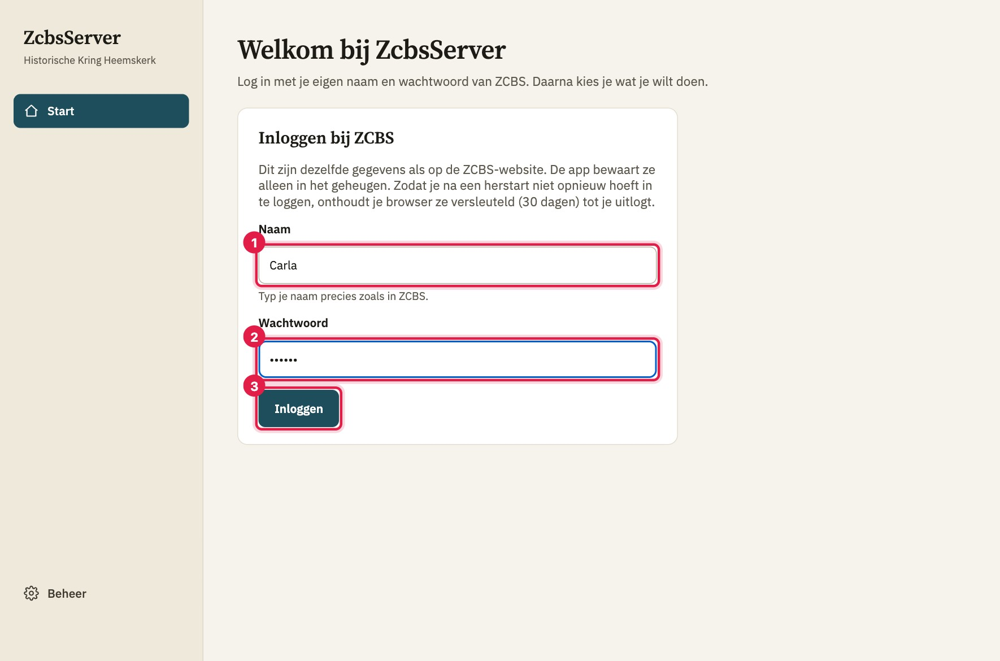
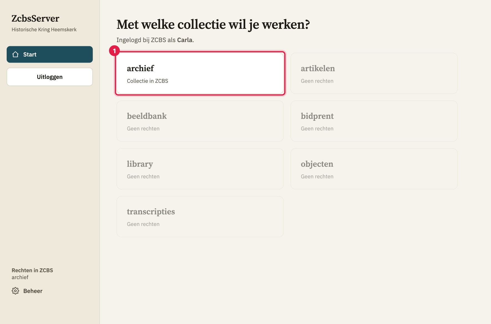
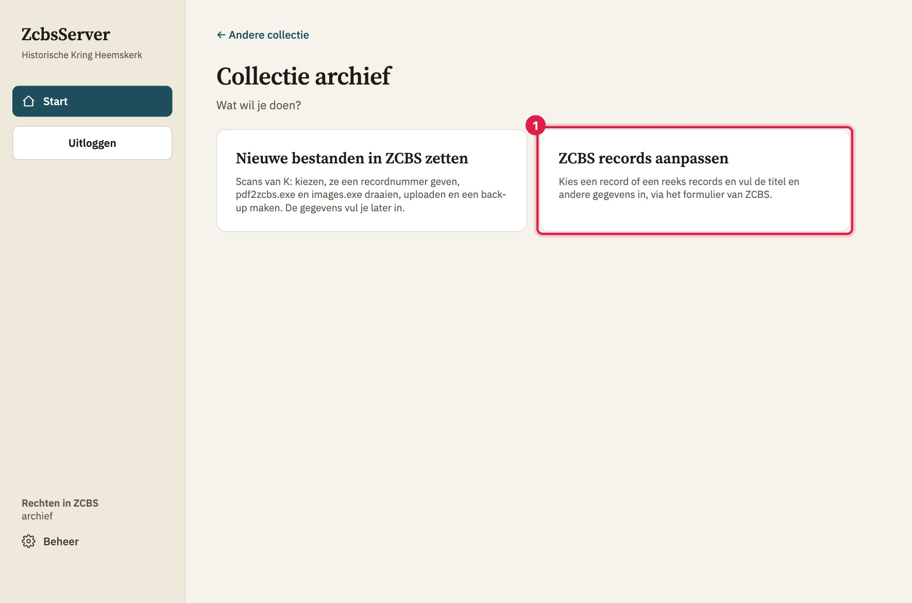
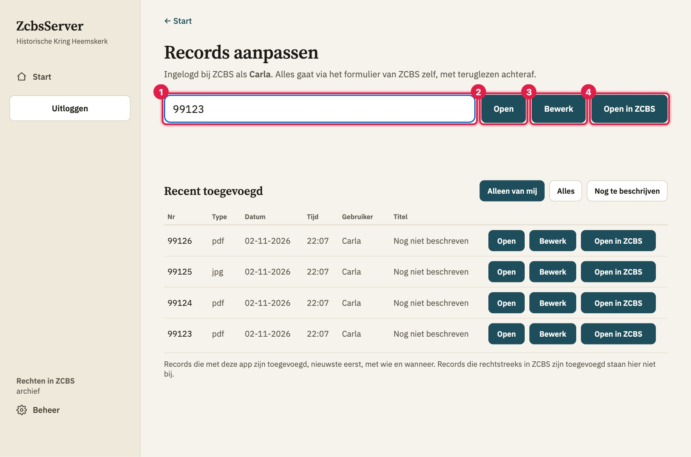
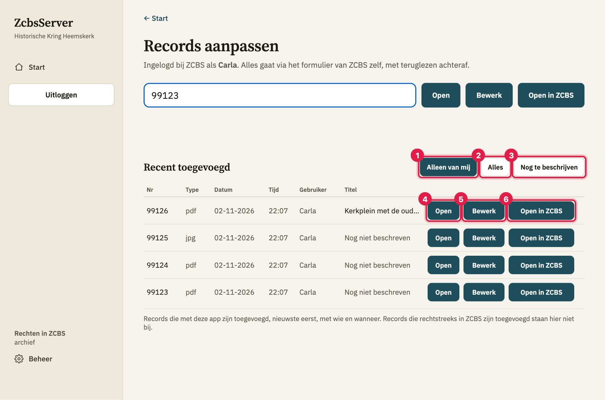
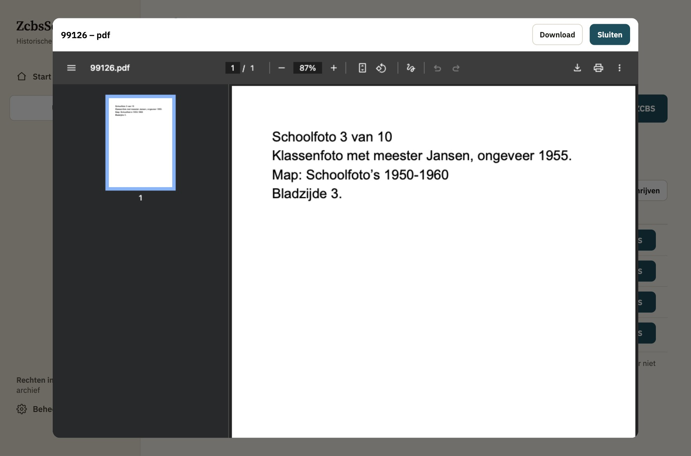
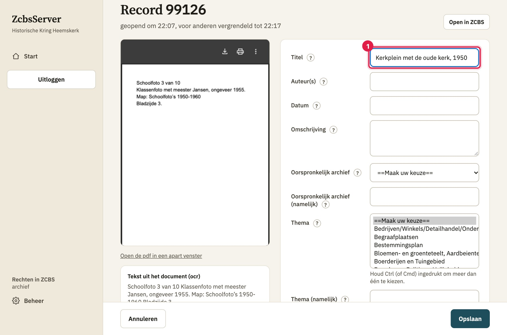
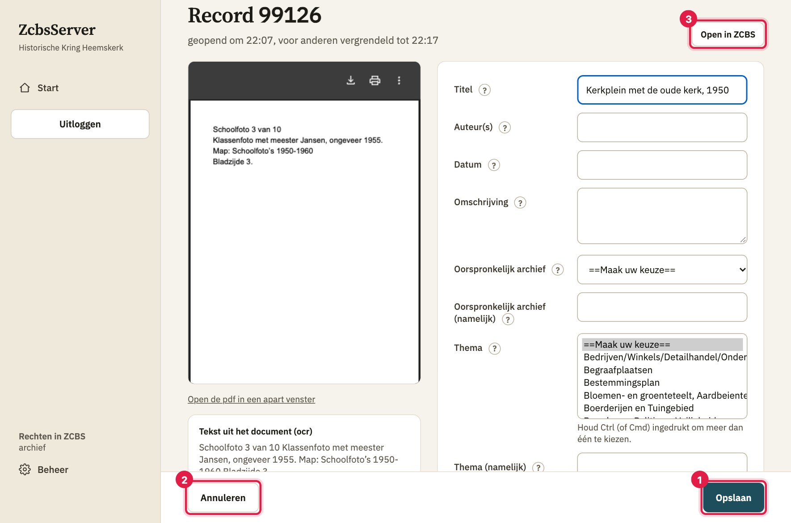
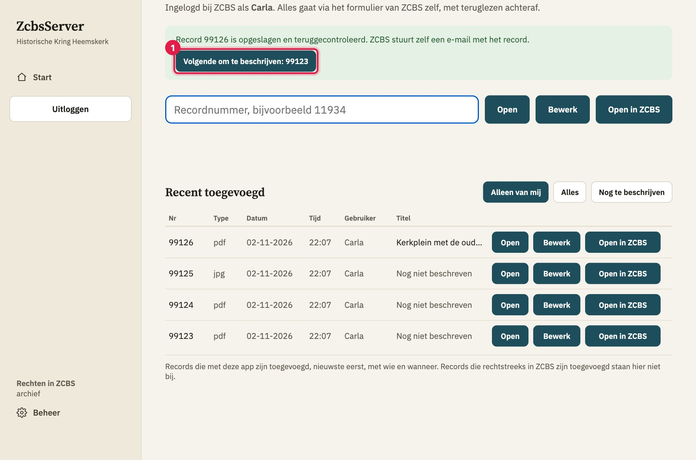

# Quickstart: ZCBS records aanpassen

Hiermee vul je de gegevens (titel, omschrijving, thema enzovoort) van records in ZCBS in. Je werkt in de app, die alles netjes in ZCBS zet. Je doet één record tegelijk.

## Wat je nodig hebt

- Je eigen **naam** en **wachtwoord** van ZCBS.
- Het **recordnummer** dat je wilt invullen, bijvoorbeeld `11934`. Records die je zelf net met de app hebt toegevoegd, staan in een lijst; dan hoef je het nummer niet te weten.

## Stappen

1. **Inloggen.** Typ bij **Naam** je naam, precies zoals in ZCBS, en bij **Wachtwoord** je wachtwoord. Klik op **Inloggen**.

   
2. **Kies de collectie.** Klik op **archief**.

   
3. **Kies wat je wilt doen.** Klik op **ZCBS records aanpassen**.

   
4. **Kies een record.** Er zijn twee manieren:
   - **Uit de lijst.** Onder **Recent toegevoegd** staan de records die met de app zijn toegevoegd, de nieuwste bovenaan. Standaard zie je alleen je eigen records
     (**Alleen van mij**). Met **Alles** zie je ook die van anderen, en met **Nog te beschrijven** de records die nog geen titel hebben.
   - **Met het nummer.** Typ het nummer in het grote veld bovenaan.

   

   
5. **Bekijk de scan.** Klik op **Open**: de pdf of afbeelding verschijnt in een venster. Met **Sluiten** sluit je het weer.

   
6. **Open het record om in te vullen.** Klik op **Bewerk** (bij het nummer of in de lijst).
   **Let op: het record is vanaf nu 10 minuten voor anderen vergrendeld.** Open dus alleen wat je echt gaat invullen.
7. **Vul de velden in.** Links zie je het document, rechts de velden. Een **?** achter een veldnaam geeft uitleg.
   Bij een lijst waar je meer dan één ding mag kiezen (zoals Thema) houd je **Ctrl** (op een Mac **Cmd**) ingedrukt.
   Bij **Plaatsing op internet** kies je **ja** of **neen**.

   
8. **Sla op.** Klik rechtsonder op **Opslaan** (of druk op Enter in een tekstveld). Met **Annuleren** ga je terug zonder iets op te slaan.

   
9. **Ga door met het volgende.** Je komt terug op het beginscherm, met een groen bericht: het record is opgeslagen en teruggecontroleerd.
   Klik op **Volgende om te beschrijven: …** om meteen het volgende record van jezelf te openen dat nog geen titel heeft.

   
10. **Klaar?** Klik in het menu op **Uitloggen**.

## Waar let je op?

- **Een record dat je opent, is 10 minuten voor anderen vergrendeld.** Ook nadat je hebt opgeslagen kan een collega er nog even niet bij.
  Staat er bij een record "*naam* heeft dit open", dan is een collega ermee bezig.
- **Annuleren** slaat niets op, en wat je had getypt is dan weg. Wil je dat houden, klik dan eerst op **Opslaan**.
- **Nog niet beschreven** betekent dat het record nog geen eigen titel heeft.
- **Staat een record niet in de lijst?** Dan is het niet met de app toegevoegd. Typ het nummer in het veld bovenaan.
- **Staat er "Er is niets gewijzigd; er is niets opgeslagen"?** Dan was er niets anders dan in ZCBS. Dat is niet erg.
- **Kopieer je tekst uit Word?** Gebogen aanhalingstekens en lange streepjes past de app zelf aan. Het euroteken (€) en andere bijzondere tekens
  kan ZCBS niet opslaan; typ dan bijvoorbeeld "euro".
- Wil je liever in ZCBS zelf werken? Klik bij het record op **Open in ZCBS**. Je bent daar meteen ingelogd.
- Uitloggen of de app herstarten wist het formulier waar je mee bezig was. Wat al is opgeslagen staat gewoon in ZCBS.

## Gaat er iets mis?

| Wat je ziet | Wat je doet |
|---|---|
| "Vul een recordnummer in" of "Vul één recordnummer in" | Typ één nummer, alleen cijfers, bijvoorbeeld `11934`. |
| "Record … bestaat niet in ZCBS." | Controleer het nummer, of kies het record uit de lijst. |
| "Bij record … staat geen pdf of afbeelding op de site." | De scan staat er nog niet. Je kunt het record wel invullen. |
| "Record ... is nog ongeveer ... minuten in gebruik bij ..." | Iemand anders heeft het record open. Wacht de genoemde tijd en klik op **Probeer opnieuw** (of **Probeer opnieuw op te slaan**; je invoer staat er nog). Of kies **Annuleren**. |
| "Dit record is niet veilig te bewerken in deze app" | Het record is te bijzonder voor de app. Klik op **Open in ZCBS** en vul het daar in. Meld het even bij de beheerder. |
| "Dit kan zo niet worden opgeslagen" met een teken of woord erbij | Haal dat teken of woord weg of vervang het, en klik weer op **Opslaan**. |
| "Iemand heeft record ... aangepast terwijl jij bezig was" | Je ziet jouw versie naast die in ZCBS. Kies **Mijn versie bewaren** of **Die van ZCBS gebruiken** (dan klik je daarna zelf nog op **Opslaan**). Weet je het niet? Vraag het de collega. |
| "Je sessie bij ZCBS is verlopen" | Probeer het nog een keer. Lukt het niet, klik op **Uitloggen**, log opnieuw in en open het record opnieuw. |
| "Controleer het record in ZCBS" | Klik op **Open in ZCBS** en kijk of je wijziging erin staat. Meld het bij de beheerder als het niet klopt. |
| "Naam of wachtwoord niet herkend, of je hebt nergens rechten" | Controleer de spelling van je naam en je wachtwoord. Blijft het fout, vraag de beheerder. Probeer het niet vaak achter elkaar. |
| De lijst blijft leeg of de melding "Het ophalen van de records is mislukt" | Laad de pagina opnieuw. Het veld bovenaan werkt ook zonder de lijst. |

Niet duidelijk? Open het record in ZCBS en meld aan de beheerder wat je zag, met het recordnummer.
