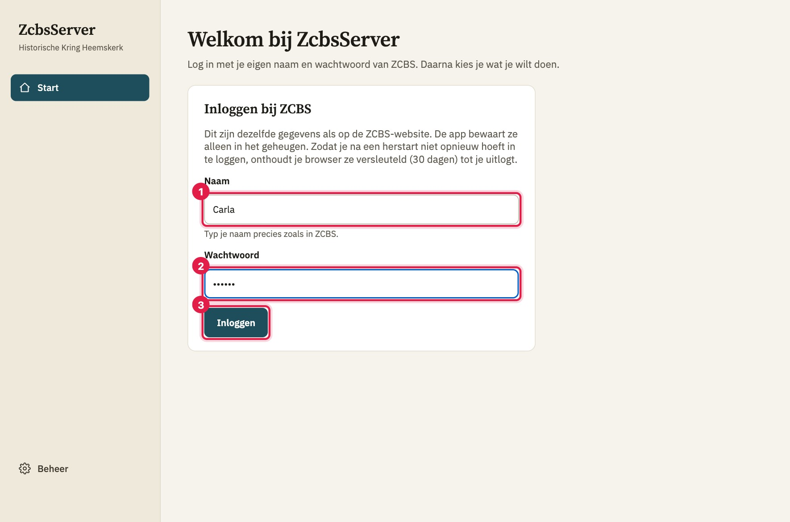
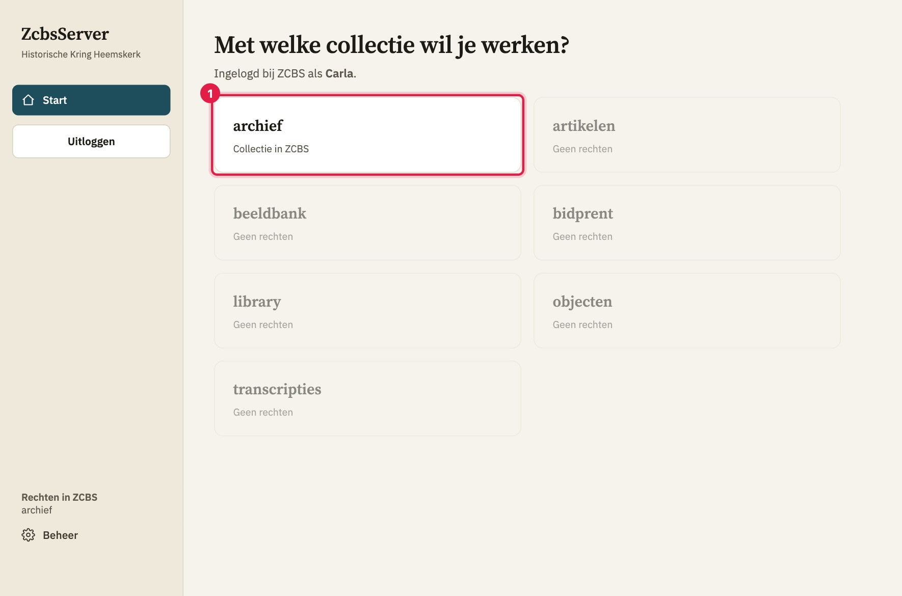
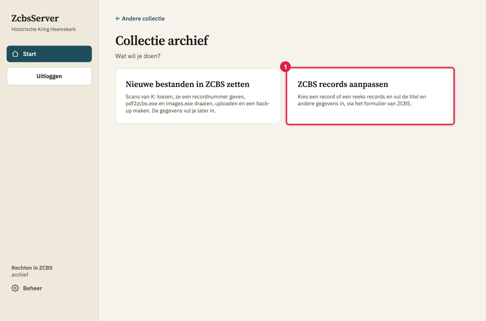
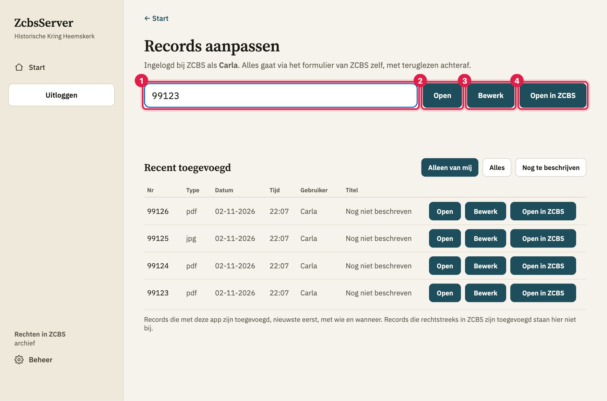
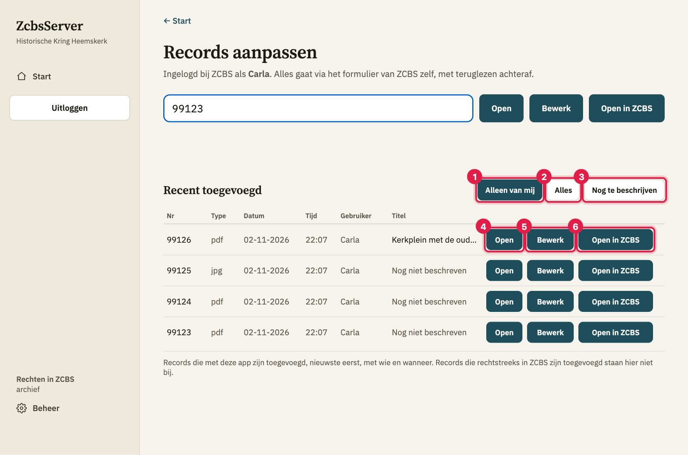
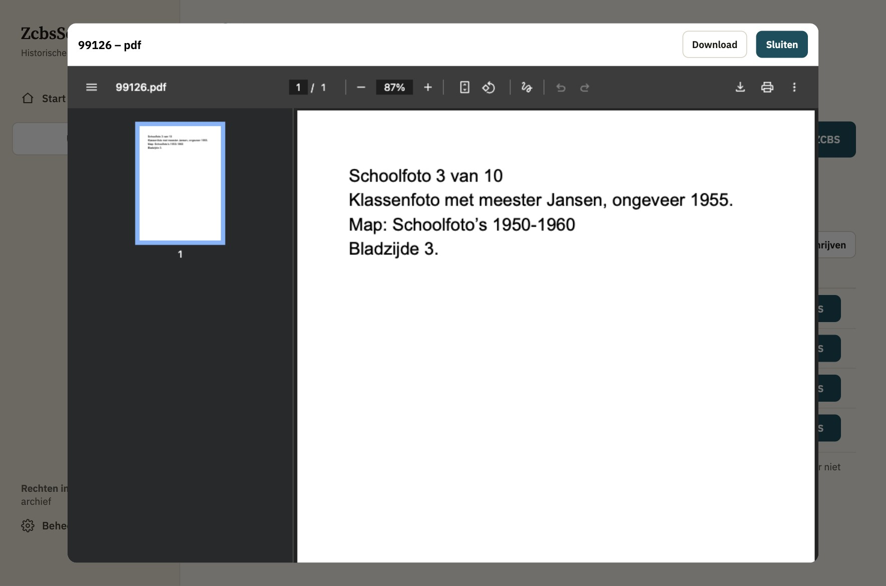
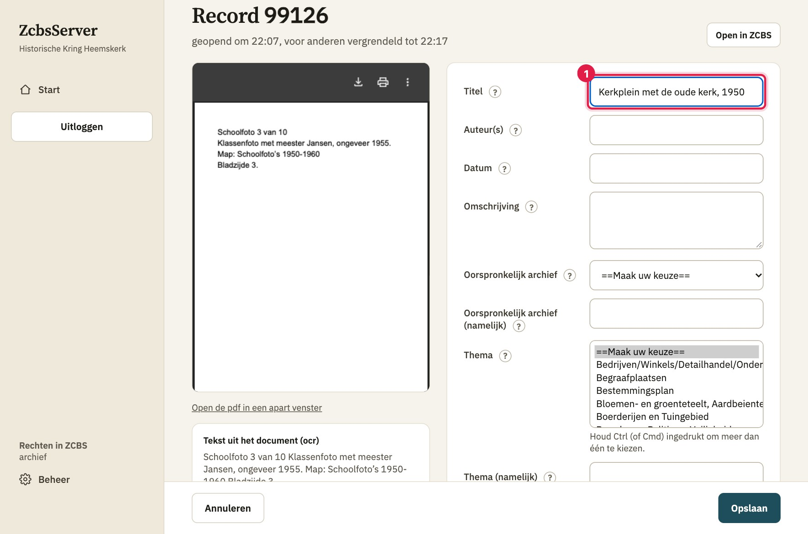
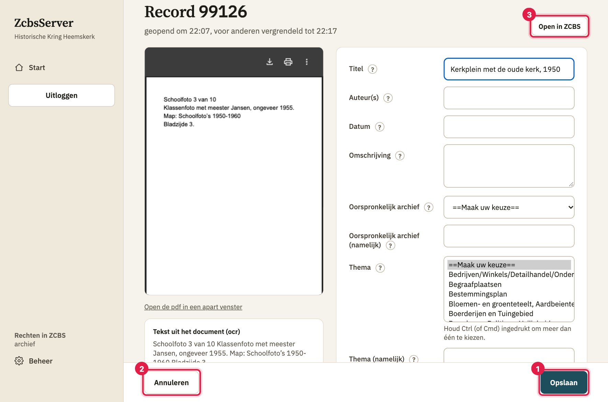
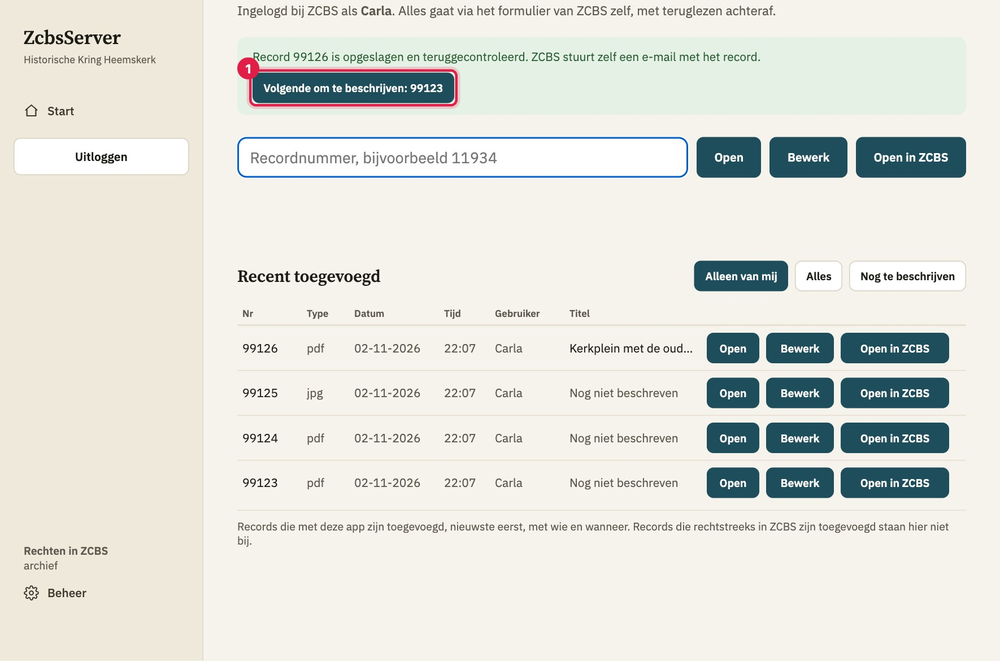

# ZCBS records aanpassen - volledige handleiding

Voor de beheerder en voor wie wil weten wat de app precies doet en controleert. Een korte handleiding voor medewerkers staat in
[quickstart-records-aanpassen.md](quickstart-records-aanpassen.md).

> **Over de bronnen.** Deze handleiding is geschreven vanuit de code en de schermen (templates) van de app, de bijbehorende tests en de
> ontwerpdocumenten in `docs/`. Waar code en documenten elkaar tegenspreken, geldt de code. De app is getest tegen een nagemaakte en een
> lokale ZCBS, niet tegen de echte server. Alles wat ZCBS zelf doet (vergrendelen, e-mail, tijdslimieten) is **uit de code gelezen,
> niet bevestigd op de echte server**; dat staat er steeds bij.

## Inhoud

1. [Wat doet deze functie?](#1-wat-doet-deze-functie)
2. [Inloggen bij ZCBS en rechten per collectie](#2-inloggen-bij-zcbs-en-rechten-per-collectie)
3. [Een record openen: het invoerveld](#3-een-record-openen-het-invoerveld)
4. [Recent toegevoegd: de lijst met records](#4-recent-toegevoegd-de-lijst-met-records)
5. [Het bewerkformulier](#5-het-bewerkformulier)
6. [Opslaan: wat de app stap voor stap doet](#6-opslaan-wat-de-app-stap-voor-stap-doet)
7. [Alle controles op een rij](#7-alle-controles-op-een-rij)
8. [Annuleren en het volgende record](#8-annuleren-en-het-volgende-record)
9. [Meer mensen tegelijk](#9-meer-mensen-tegelijk)
10. [Het workflow-logboek](#10-het-workflow-logboek)
11. [Problemen en oplossingen](#11-problemen-en-oplossingen)
12. [Woordenlijst](#12-woordenlijst)

---

## 1. Wat doet deze functie?

Met **ZCBS records aanpassen** vul je de gegevens in van records die al in ZCBS bestaan (bijvoorbeeld net aangemaakt met de flow *Nieuwe bestanden in ZCBS
zetten*): titel, omschrijving, thema enzovoort. Je werkt **één record tegelijk**. De app is daarbij geen eigen database. Hij werkt als een browser:

- hij haalt het **bewerkformulier van ZCBS** op, precies zoals ZCBS het zelf aanbiedt (de velden en de keuzelijsten komen uit ZCBS);
- hij toont dat formulier in de eigen schermen van de app, naast de pdf of afbeelding van het record;
- bij **Opslaan** stuurt hij het formulier terug naar ZCBS, als een gewone ZCBS-opslag, en leest het record daarna terug om te controleren
  of ZCBS het echt zo heeft bewaard.

De app schrijft dus nooit rechtstreeks in bestanden van ZCBS. Alles wat de app doet, kun je ook in ZCBS zelf doen; bij elk record staat
daarom de knop **Open in ZCBS** als terugvaloptie.

Het pad door de app: **Start** (inloggen) - collectie kiezen - **Wat wil je doen?** - **ZCBS records aanpassen**. Het scherm heeft twee delen: bovenaan een
**invoerveld** voor één recordnummer (hoofdstuk 3) en daaronder **Recent toegevoegd**, de lijst met de records die met de app zijn toegevoegd (hoofdstuk 4).
Na het opslaan kom je op dit scherm terug, met een knop naar het volgende record dat nog beschreven moet worden.

Alleen de collectie **archief** is nu beschikbaar. Andere collecties staan wel op de keuzepagina, maar als "Nog niet beschikbaar" of
"Geen rechten".

---

## 2. Inloggen bij ZCBS en rechten per collectie

### 2.1 Inloggen

Op de startpagina (**Welkom bij ZcbsServer**) staat het blok **Inloggen bij ZCBS** met de velden **Naam** en **Wachtwoord** en de knop
**Inloggen**. Gebruik dezelfde gegevens als op de ZCBS-website; typ de naam precies zoals in ZCBS. Zonder inlog stuurt de app je bij elke
pagina van Carla's functies terug naar de startpagina met de melding "Log eerst in bij ZCBS."

Het ZCBS-adres hoeft de medewerker niet te kennen. De beheerder zet dat bij **Instellingen** (daar kiest hij ook tussen de test-ZCBS op de
eigen computer en het echte archief). Is er geen adres ingesteld, dan staat op de startpagina "Het adres van ZCBS is nog niet ingesteld."

Wat er met naam en wachtwoord gebeurt (uit de code gelezen):

- De app bewaart ze in het **geheugen** van de server, zodat hij later opnieuw kan inloggen als de ZCBS-sessie verloopt (zie 7.6).
- Bij een geslaagde inlog zet de app ook een **versleuteld cookie** in de browser (naam: `hkh_inloggen`, 30 dagen, alleen voor deze app, met
  een sleutelbestand naast het instellingenbestand). Daarmee logt de app je na een herstart van de app vanzelf weer in. **Uitloggen** haalt
  het cookie weg. Een computer waar anderen bij kunnen, is dus geen plek om ingelogd te blijven.
- Wijzigt het ZCBS-adres in de instellingen (bijvoorbeeld van test naar echt archief), dan geldt de oude inlog niet meer en word je uitgelogd.
- Het wachtwoord komt niet in het workflow-logboek; wel meldt de app een inlogpoging (naam, gelukt of niet, via wachtwoord of cookie, en de
  foutmelding) aan dat logboek.

> Let op: de tekst op de startpagina zegt dat de app de gegevens "alleen bewaart zolang hij draait". Het versleutelde cookie hierboven is
> daar een uitzondering op. Zie ook het overzicht onderaan.

### 2.2 Rechten per collectie

In ZCBS gelden rechten **per collectie**. De app probeert daarom dezelfde naam en hetzelfde wachtwoord bij het ZCBS-script van **elke
collectie** (archief, artikelen, beeldbank, bidprent, library, objecten, transcripties). Je bent ingelogd zodra het bij **minstens één**
collectie lukt.

- Linksonder in het menu staat **Rechten in ZCBS**: de collecties waar je inlog is gelukt (of "geen").
- Op de pagina **Met welke collectie wil je werken?** zijn alleen collecties klikbaar waar je rechten hebt **en** waar de app mee werkt.
  Andere tonen "Geen rechten" of "Nog niet beschikbaar". Nu werkt alleen **archief**.
- Heb je alleen rechten bij een andere collectie (bijvoorbeeld de beeldbank), dan kun je wel inloggen, maar niet met het archief werken.
- ZCBS geeft bij een **fout wachtwoord** en bij een **ontbrekend recht** hetzelfde antwoord. De app kan die twee niet uit elkaar houden en
  meldt in beide gevallen: "Naam of wachtwoord niet herkend, of je hebt nergens rechten."

### 2.3 Uitloggen

De knop **Uitloggen** (in het menu) wist de ZCBS-sessie van deze gebruiker, **inclusief het record dat je open hebt en alles wat nog
niet is opgeslagen**. Daarna open je het record opnieuw.

In het menu staat onderaan in rood **Het echte archief** zodra je bent ingelogd en de app naar het echte ZCBS wijst (niet naar de test-ZCBS).
Dan is alles wat je opslaat echt.

---

## 3. Een record openen: het invoerveld

Bovenaan de pagina **Records aanpassen** staat één groot invoerveld **Recordnummer** met drie knoppen. Typ één recordnummer, bijvoorbeeld `11934`, en kies:

| Knop | Wat hij doet |
|---|---|
| **Open** | Toont de pdf of afbeelding van dat record in een venster op deze pagina. Er wordt niets vergrendeld en er verandert niets. |
| **Bewerk** | Opent het record om te bewerken: het formulier van ZCBS (hoofdstuk 5). **Dat vergrendelt het record 10 minuten voor anderen.** **Enter** in het veld doet hetzelfde. |
| **Open in ZCBS** | Opent het record in ZCBS zelf, in een nieuw tabblad, meteen ingelogd (zie hieronder). Alleen kijken: dat vergrendelt niet. |

Regels:

- Het is **één nummer**: geen reeksen en geen lijstjes met komma's. Meer records bewerk je na elkaar.
- De app vult het nummer aan met nullen tot de lengte die ZCBS gebruikt (standaard 5 cijfers: `42` wordt `00042`). Je mag maximaal 9 cijfers typen.
- De controle van het nummer gebeurt meteen in de pagina, met een melding onder het veld (niet de melding van de browser): bij een leeg veld "Vul een recordnummer in,
  bijvoorbeeld 11934." en bij iets anders dan cijfers (of meer nummers) "Vul één recordnummer in, bijvoorbeeld 11934."
- **Open** vraagt eerst aan de app welk bestand het record heeft ("Scan zoeken…"). De pdf gaat voor; staat er geen pdf maar wel een grote afbeelding
  (`archief/large/<nummer>.jpg`), dan krijg je die. Staat er niets: "Bij record 11934 staat geen pdf of afbeelding op de site." Lukt het ophalen niet:
  "De scan kon niet worden opgehaald. Probeer het opnieuw."
- **Bewerk** zoekt het record eerst op in ZCBS, met de gewone weergave. Dat is alleen lezen en **zet geen vergrendeling**. "Bestaat niet" betekent dat ZCBS
  antwoordt dat het record niet beschikbaar is: "Record 11934 bestaat niet in ZCBS." Geeft ZCBS geen duidelijk antwoord, dan telt het record als "bestaat";
  het bewerken meldt het zelf als het toch niet klopt. Is ZCBS niet bereikbaar: "Geen verbinding met ZCBS: ...".
- Open je een ander record, dan vervangt dat het vorige; wat je daar nog niet had opgeslagen, is weg.

**Hoe Open in ZCBS werkt (uit de code gelezen).** De app opent een tabblad met een pagina "Record 11934 wordt geopend in ZCBS…" die je browser met één formulier de
naam, het wachtwoord en het recordnummer naar ZCBS laat sturen. ZCBS toont dan het record en zet zijn eigen cookies, zodat je daar ingelogd blijft. Die pagina bevat je
wachtwoord en wordt daarom nooit onthouden of doorgegeven (de browser mag haar niet bewaren en stuurt geen verwijzer mee). Ben je niet ingelogd, of is het geen recordnummer, dan
volgt "Je bent niet ingelogd bij ZCBS of dit is geen recordnummer."

---

## 4. Recent toegevoegd: de lijst met records

Onder het invoerveld staat **Recent toegevoegd**: de records die **met deze app zijn toegevoegd** (de flow *Nieuwe bestanden in ZCBS zetten*), nieuwste eerst. Je kiest er
dus een record uit zonder het nummer te hoeven weten. Na een geslaagde doorloop van Nieuwe bestanden staan de nieuwe records hier bovenaan.

- De lijst komt uit het **verwerkt-log** van de app (hoofdstuk 12 van de handleiding *Nieuwe bestanden*). **Records die iemand rechtstreeks in ZCBS heeft toegevoegd, staan er niet bij**:
  daarvoor typ je het nummer in het invoerveld. Heeft een record vaker in het log gestaan, dan telt de laatste keer.
- De **datum, tijd en gebruiker** zijn die van het **toevoegen**. Het aanpassen van een record verandert ze niet.
- De app laat per keer **20 records** zien; **Meer laden** haalt er 20 bij. Hij kijkt daarbij naar de laatste ongeveer 200 toegevoegde records.
- De pagina en het invoerveld staan er meteen. De lijst zelf wordt apart opgehaald ("Recente records ophalen…"), omdat de titels uit ZCBS komen en dat even duurt.
  Lukt dat niet, dan staat er "Het ophalen van de records is mislukt. Laad de pagina opnieuw." of "De records konden niet worden opgehaald: ...".

### 4.1 De filters

Boven de lijst staan drie knoppen; de gekozen knop is donker.

| Filter | Wat je ziet |
|---|---|
| **Alleen van mij** (standaard) | Alleen de records die **jij** hebt toegevoegd (op je ZCBS-naam, hoofdletters tellen niet). |
| **Alles** | De records van alle gebruikers van de app. |
| **Nog te beschrijven** | De records van alle gebruikers die **nog geen titel hebben** (zie hieronder). |

Is een lijst leeg, dan zegt de app waarom: "Je hebt nog geen records toegevoegd met deze app. Kies Alles om te zien wat anderen toevoegden." (Alleen van mij), "Er zijn nog geen
records toegevoegd met deze app." (Alles) of "Alle recent toegevoegde records hebben een titel." (Nog te beschrijven).

### 4.2 De kolommen

| Kolom | Betekenis |
|---|---|
| **Nr** | Het recordnummer. |
| **Type** | `pdf` of `jpg`: wat er op de site bij het record staat. Leeg als er (nog) geen bestand is. |
| **Datum** en **Tijd** | Wanneer het record met de app is toegevoegd (dd-mm-jjjj en uu:mm). |
| **Gebruiker** | Wie het toevoegde (hooguit 8 tekens). |
| **Titel** | De titel in ZCBS. **Nog niet beschreven** staat er voor een record dat nog geen eigen titel heeft. Heeft een ander het record nu open, dan staat er "*naam* heeft dit open". |
| (knoppen) | Zie 4.3. |

Op smallere schermen verdwijnen eerst de kolom Gebruiker en daarna Datum en Tijd.

**Nog niet beschreven** betekent: de titel is leeg of de standaardtitel die `images.exe` aan nieuwe records geeft ("Een nog niet beschreven record (jjmmdd)"). Zodra iemand een
andere titel opslaat, is het record beschreven. De titels komen uit ZCBS zelf (de gewone weergave, zonder te vergrendelen) en worden **5 minuten onthouden**; na het opslaan van een
record vergeet de app zijn titel meteen. Kan ZCBS een titel niet tonen (bijvoorbeeld omdat een ander het record op dat moment open heeft), dan blijft de titel leeg en probeert de app het de volgende keer opnieuw.

### 4.3 De knoppen per rij

| Knop | Wat hij doet |
|---|---|
| **Open** | Toont de pdf of afbeelding van het record in een venster. De knop staat er alleen als er een bestand op de site staat. |
| **Bewerk** | Opent het record om te bewerken (hoofdstuk 5). |
| **Open in ZCBS** | Opent het record in ZCBS zelf, in een nieuw tabblad, meteen ingelogd (zie hoofdstuk 3). |

**Het venster bij Open.** Bovenin staat de titel ("nummer - titel"), met de knoppen **Download** en **Sluiten**. Klik naast het venster om het ook te sluiten. De pdf gaat voor; staat er
geen pdf maar wel een grote afbeelding, dan zie je die.

**"*naam* heeft dit open".** Dit label staat bij een record dat een andere gebruiker op dat moment in de app geopend heeft; ZCBS houdt het dan 10 minuten voor jou dicht (zie 7.1).
Het label weet niets van mensen die het record rechtstreeks in ZCBS bewerken.

---

## 5. Het bewerkformulier

Klik op **Bewerk**, in de lijst of bij het invoerveld. De app haalt dan het formulier van ZCBS op. **Dat vergrendelt het record voor andere
gebruikers (10 minuten)**. De kop toont: "geopend om 14:32, voor anderen vergrendeld tot 14:42" (voorbeeldtijden).

Bovenaan: **← Terug naar Records aanpassen**, het recordnummer met de naam van het bestand en rechts **Open in ZCBS** (dat opent hier het bewerkformulier van
ZCBS zelf, en vergrendelt dus ook).

### 5.1 Links: het document

- De pdf van het record, ingebed. Ontbreekt die, dan de grote afbeelding met de uitleg dat de pdf nog niet op de site staat.
- Ontbreken ze allebei: een kader "de pdf van dit record staat (nog) niet op de site" met het pad.
- De link **Open de pdf in een apart venster**.
- Als de site een tekstbestand (ocr) heeft: een kader **Tekst uit het document (ocr)** met de eerste 800 tekens.

### 5.2 Rechts: de velden

De velden, hun volgorde en hun keuzelijsten komen **rechtstreeks uit ZCBS**. De app heeft geen vaste veldenlijst; een nieuw veld in ZCBS
verschijnt vanzelf. Een vraagteken (**?**) achter een veldnaam toont de helptekst die ZCBS erbij geeft. Voorbeelden van velden (uit de
testopname van een ZCBS-formulier, de echte lijst kan verschillen): Titel, Omschrijving, Thema, Trefwoord, Plaatsing op internet.

| Soort veld | Hoe het eruitziet en werkt |
|---|---|
| Tekstveld | Een regel tekst. |
| Tekstvak | Meerdere regels. Regeleinden mogen; ZCBS maakt er ` ` van. |
| Keuzelijst | Een uitklaplijst; je kiest er één. |
| **Meerkeuze** (bijvoorbeeld Thema) | Een lijst waarin je er meer dan één kiest: **houd Ctrl (of Cmd) ingedrukt**. Kies je niets, dan wordt het veld leeg. Meerdere keuzes worden in ZCBS opgeslagen gescheiden door "; ". |
| Keuzerondjes | Eén keuze. **Plaatsing op internet** heeft de keuzes **neen** en **ja**. |

**"Anders".** Veel keuzelijsten van ZCBS hebben de keuze `== Anders ==`. Kies je die, dan vul je de eigen waarde in het bijbehorende veld
met de toevoeging **(namelijk)**. Bij opslaan vervangt ZCBS `== Anders ==` door die tekst. Velden met de toevoeging **(extra)** zijn aanvullende
tekstvelden bij een keuzelijst; hun inhoud wordt in ZCBS achter de keuze gezet, gescheiden door een verticale streep (`keuze|extra`). Wie
een nieuwe "Anders"-waarde opslaat, veroorzaakt (volgens de ontwerpdocumenten, niet bevestigd op de echte server) een mail van ZCBS aan de
beheerder, zodat die de waarde aan de lijst kan toevoegen.

**Plaatsing op internet.** Je kiest alleen **ja** of **neen**. De waarde achter "ja" komt uit het formulier van ZCBS zelf (ZCBS legt de datum vast);
de app verzint niets. In de lijst zie je het resultaat als **ja** of **nee**.

**Wat de app aan je invoer verandert** (voordat hij wordt vergeleken en opgeslagen):

- Spaties voor en na de tekst verdwijnen.
- Tekens uit Word worden vervangen door tekens die ZCBS aankan: gebogen aanhalingstekens worden gewone (`"` en `'`), een lange of korte
  streep wordt `-`, het beletselteken (drie puntjes in één teken) wordt `...`, niet-brekende spaties worden gewone spaties en onzichtbare
  nulbreedte-spaties verdwijnen.
- Regeleinden worden gelijkgetrokken.

Velden die jij niet aanraakt, blijven zoals ze in ZCBS stonden. Ook velden die het formulier niet toont (bijvoorbeeld een veld dat ZCBS
niet als invoerveld aanbiedt) neemt de app uit het oorspronkelijke record mee, zodat ze niet per ongeluk leeg worden opgeslagen.

### 5.3 De knoppen onderaan

| Knop | Wat hij doet |
|---|---|
| **Opslaan** (rechts) | Slaat dit record op (zie hoofdstuk 6) en gaat daarna terug naar Records aanpassen. **Enter** in een tekstveld doet hetzelfde. |
| **Annuleren** (links) | Slaat **niets** op en gaat terug naar Records aanpassen. Wat je had getypt, wordt niet bewaard. |

Er is op het formulier geen weg naar een volgend record. Dat doe je vanaf Records aanpassen, na het opslaan (zie 5.4).

### 5.4 Na het opslaan

Na een geslaagde opslag kom je terug op **Records aanpassen**, met een groen bericht: "Record N is opgeslagen en teruggecontroleerd. ZCBS stuurt zelf een e-mail met het record."
Die e-mail wordt door ZCBS verstuurd bij een opslag, niet door deze app (volgens de ontwerpdocumenten; niet bevestigd op de echte server).

Onder het bericht staat, na een ogenblik ("Het volgende record zoeken…"), de knop **Volgende om te beschrijven: *nummer***. Dat is het eerstvolgende **eigen** record (door jou toegevoegd)
dat nog niet is beschreven: het eerstvolgende hogere nummer, anders het laagste. Zo werk je de nieuwe records op volgorde af. Is er geen record meer te beschrijven, dan staat de knop er niet.

---

## 6. Opslaan: wat de app stap voor stap doet

Een klik op **Opslaan** zet de volgende stappen in gang. Stopt een stap, dan gebeurt er niets in ZCBS tenzij anders vermeld, en je invoer
blijft in de app staan (je ziet haar terug in het formulier).

1. **Wijzigingen bepalen.** De app vergelijkt je invoer met het formulier zoals het was toen je het record opende. Is er niets anders:
   "Er is niets gewijzigd; er is niets opgeslagen." en er gaat niets naar ZCBS.
2. **Tekens en woorden controleren** (7.3 en 7.4) op de velden die je wijzigde. Bij een probleem: rode melding **Dit kan zo niet worden
   opgeslagen.** Niets naar ZCBS.
3. **Opnieuw inloggen** bij ZCBS met de bewaarde gegevens. Zo kan een verlopen ZCBS-sessie het opslaan niet meer breken.
   Lukt dat niet, dan volgt de melding over de verlopen sessie (7.6).
4. **Het formulier opnieuw ophalen.** Dat vergrendelt het record opnieuw op jouw naam (ook als de eerste 10 minuten al voorbij zijn) en geeft de
   nieuwste stand van het record. Is het record intussen door een ander vergrendeld, dan krijg je de melding over de vergrendeling (7.1).
5. **Opnieuw controleren of de app het record begrijpt** (7.2) op die verse versie.
6. **Controle op tussentijdse wijzigingen** (7.5): heeft iemand anders het record veranderd sinds jij het opende? Zo ja en is het **hetzelfde veld** dat
   jij wijzigde: conflictscherm. Veranderde de ander een **ander** veld, dan blijft die wijziging gewoon behouden en gaat jouw wijziging erbij.
7. **Versturen.** De app stuurt het formulier naar ZCBS (met jouw wijzigingen op de verse versie, alle andere velden ongewijzigd) in het
   tekensysteem van ZCBS (latin-1).
8. **Teruglezen.** De app haalt het record nogmaals op en vergelijkt het met wat hij verstuurde, veld voor veld (7.7). Pas als alles gelijk is,
   telt het record als opgeslagen: je gaat terug naar Records aanpassen en het groene bericht volgt (5.4).

Er is **één poging**; bij een netwerkfout herhaalt de app niet automatisch, omdat de opslag toch gelukt kan zijn. Je krijgt dan een melding
om in ZCBS te controleren.

---

## 7. Alle controles op een rij

### 7.1 Vergrendeling (10 minuten, door ZCBS)

Het ophalen van het bewerkformulier (en ook het opslaan) vergrendelt het record in ZCBS voor **andere gebruikersnamen**. Uit de ontwerpdocumenten
(code van ZCBS gelezen, niet bevestigd op de echte server):

- de vergrendeling duurt 10 minuten en wordt bij elk nieuw verzoek met bewerken verlengd;
- ze hoort bij de **gebruikersnaam**: wie met dezelfde naam is ingelogd, blokkeert zichzelf niet;
- ze wordt na het opslaan **niet** vrijgegeven; een collega moet dus nog tot 10 minuten wachten;
- gewoon bekijken (de lijst, **Open**, **Open in ZCBS** vanuit de lijst of het invoerveld) vergrendelt niet. Wel vergrendelt de knop **Open in ZCBS** op de recordpagina,
  want die opent het bewerkformulier van ZCBS;
- de app geeft vergrendelingen nooit zelf vrij.

Is een record door een ander vergrendeld, dan meldt ZCBS dat, bijvoorbeeld: "Record 11934 is nog ongeveer 10 minuten in gebruik bij Jelly. Je invoer
blijft bewaard." Je ziet dat in een geel kader met de knoppen **Probeer opnieuw** en **Annuleren**. Bij het opslaan verschijnt
in plaats daarvan de knop **Probeer opnieuw op te slaan**, met je invoer nog in het formulier.

Open in de app alleen de records die je echt gaat bewerken: elk geopend record is 10 minuten voor anderen vergrendeld.

### 7.2 Begrijpt de app het record veilig genoeg? (melding "niet veilig")

Bij elk formulier dat de app van ZCBS ophaalt, bouwt hij uit de ongewijzigde velden het record **zelf opnieuw op**, op dezelfde manier als ZCBS bij
het opslaan (keuzes samenvoegen met "; ", `== Anders ==` vervangen, subvelden met "|", regeleinden als ` `, dubbele spaties weg enzovoort).
Dat resultaat moet **gelijk zijn aan het oorspronkelijke record** dat ZCBS meestuurt. In de code heet dat `RecordRebuilder.differences`.

Is er een verschil, dan zou de app bij opslaan iets anders wegschrijven dan er stond. Daarom weigert hij het record: een rode melding met de kop
"Dit record is niet veilig te bewerken in deze app.", met de tekst "De app begrijpt dit record niet goed genoeg om het veilig op te slaan
(verschil in: ...). Er is niets gewijzigd. Open het record in ZCBS." Je kunt dan **Open in ZCBS** gebruiken of **Annuleren**.
Dezelfde controle gebeurt opnieuw vlak voor het opslaan; verschilt het formulier dan, dan krijg je: "Het formulier van ZCBS wijkt nu af van wat
de app begrijpt; er is niets opgeslagen. Open het record in ZCBS."

Een leeg record dat in het formulier "neen" toont terwijl het veld leeg is, en regeleinden waar een browser een spatie voor zet, worden bewust
niet als verschil gezien.

### 7.3 Tekens die ZCBS niet kan opslaan (latin-1)

ZCBS slaat tekst op in latin-1 (ISO-8859-1). Letters als e met trema, e met accent en n met tilde passen daarin. Tekens daarbuiten, zoals het
euroteken of Japanse tekens, niet. Veelvoorkomende Word-tekens worden automatisch vervangen (5.2). Voor de rest blokkeert de app het opslaan
met een melding als: "In "Titel" staat het teken '€'. ZCBS kan dat niet opslaan; haal het weg of vervang het." Er gaat niets naar ZCBS.

### 7.4 Woorden die ZCBS weigert

ZCBS weigert bepaalde woorden in een veld; dan mislukt de hele opslag met een lege pagina. De app controleert dat vooraf en meldt:
"In "Omschrijving" staat het woord "SELECT". ZCBS weigert dat in een veld; gebruik een ander woord." De geweigerde woorden zijn:

- SQL-achtige woorden **in hoofdletters**: `SELECT`, `UNION`, `FROM`, `CONCAT`, `CHAR(`, `NULL`, `THEN(`, ook `name_const`, `benchmark` en `select*from`;
- gebeurtenisnamen uit webpagina's, ook in kleine letters: `onload`, `onclick`, `onerror`, `onfocus`, `onselect`, `onsubmit`;
- bestandsnamen van ZCBS: `permit.lst`, `objecten.pl`, `cfg-cbs.pl` (en varianten met een cijfer).

Gewone woorden in kleine letters (`select`, `from`, `null`) en woorden als Heemskerk, scriptie of manuscript zijn geen probleem.
De controle geldt voor de velden die je wijzigt.

### 7.5 Tussentijdse wijziging door een ander (conflict)

Bij het opslaan vergelijkt de app het verse record met de versie van toen je opende.

- Is er niets veranderd, of is een **ander** veld veranderd dan jij wijzigde: geen probleem. De wijziging van de ander blijft staan en de jouwe
  komt erbij.
- Is **hetzelfde veld** door iemand anders gewijzigd: er verschijnt een geel kader **Iemand heeft record N aangepast terwijl jij bezig was.**
  met de tabel **Veld / Jouw versie / Nu in ZCBS**. Er is nog niets opgeslagen. Je kiest:
  - **Mijn versie bewaren**: jouw wijzigingen worden opgeslagen, en vervangen voor die velden wat de ander schreef.
  - **Die van ZCBS gebruiken**: voor de velden die botsen kiest de app de versie uit ZCBS. Jouw andere wijzigingen blijven in het formulier staan.
    Er wordt nog niets opgeslagen; je ziet het bericht "De velden die botsten zijn vervangen door de versie uit ZCBS. Controleer het
    formulier en sla dan op." Daarna klik je zelf op **Opslaan**.

Overleg bij twijfel met de collega die het record ook bewerkte.

### 7.6 Verlopen sessie: opnieuw inloggen

ZCBS beëindigt een sessie na enkele minuten stilstand (volgens de ontwerpdocumenten 10 minuten op een gewoon adres, 60 op het HKH-netwerk; niet
bevestigd op de echte server). De app vangt dat zelf op:

- bij **openen**: ziet de app dat de sessie verlopen is, dan logt hij met de bewaarde gegevens opnieuw in en probeert het nog eens;
- bij **opslaan**: de app logt altijd eerst opnieuw in (stap 3 in hoofdstuk 6).

Lukt het opnieuw inloggen niet (bijvoorbeeld omdat het wachtwoord intussen is gewijzigd), dan zie je "Je sessie bij ZCBS is verlopen. Log
opnieuw in." (bij opslaan met de toevoeging "je invoer blijft bewaard"). Zie [hoofdstuk 11](#11-problemen-en-oplossingen) voor wat je dan doet.

### 7.7 Teruglezen na opslaan

Na het versturen haalt de app het record opnieuw op uit ZCBS en vergelijkt hij alle velden van het record met wat hij verstuurde, rekening
houdend met wat ZCBS zelf mag aanpassen. Klopt een veld niet, dan krijg je bijvoorbeeld:

> Opgeslagen, maar "Titel" is nu "..." in plaats van "...". Controleer het record in ZCBS.

Je krijgt dan een rode melding (ook al kan een deel wel zijn opgeslagen): controleer het record in ZCBS. Kan het record niet teruggelezen worden:
"Het record kon niet teruggelezen worden (...). Controleer in ZCBS of het is opgeslagen."

### 7.8 E-mail naar de beheerder

Een opslag in ZCBS stuurt een e-mail. De app zegt dat in het groene bericht ("ZCBS stuurt zelf een e-mail met het record"). Volgens de ontwerpdocumenten (ZCBS-code gelezen) mailt ZCBS bij elke opslag het volledige record naar het archief-adres en bij een
nieuwe "Anders"-waarde ook naar de beheerder. Bij een opslag waarbij niets is veranderd, stuurt ZCBS niets. De app verstuurt zelf geen e-mail.
**Niet bevestigd op de echte server**; de lokale ZCBS voor de tests verstuurt geen e-mail.

---

## 8. Annuleren en het volgende record

- **Annuleren** slaat **niets** op en de app bewaart de tekst die je net had getypt **niet**. Wil je je invoer houden, sla dan eerst op. Een record dat al was opgeslagen, blijft opgeslagen.
- Er is geen "volgende zonder opslaan" en geen "opslaan en volgende" meer: na het opslaan kom je terug op Records aanpassen en kies je daar het volgende record (5.4), of
  typ je een nummer.
- Het opgehaalde formulier is een momentopname. Open je een record dat je eerder liet liggen opnieuw, dan haalt de app de nieuwste versie uit ZCBS
  op (en vergrendelt het opnieuw).
- Je invoer blijft in het formulier staan als een **opslagpoging** mislukt (vergrendeld, conflict, verboden teken of woord, verlopen sessie). Dat is
  zo zolang de app draait en je niet uitlogt.
- Er is geen beperking dat je maar één record tegelijk opent, maar de app onthoudt er steeds één: opent je een ander record, dan vervangt dat het vorige.
  Elk geopend record is 10 minuten vergrendeld, ook als je het niet bewerkt of annuleert.

---

## 9. Meer mensen tegelijk

Dat mag. Elke ingelogde gebruiker heeft een **eigen sessie** in de app: een eigen inlog, een eigen geopend record en
een eigen ingevoerde tekst. Eén gebruiker uitloggen logt een ander niet uit. De beheerder ziet onder **Instellingen** - **Sessies** wie er is
ingelogd bij ZCBS.

De lijst **Recent toegevoegd** is voor iedereen dezelfde (de filters bepalen wat je ziet), en een record dat een ander open heeft, krijgt het label "*naam* heeft dit open".

Wat ze elkaar kunnen doen, regelt **ZCBS**: de vergrendeling per record (7.1) en, daarbovenop, de conflictcontrole van de app (7.5). Twee mensen met
**dezelfde ZCBS-naam** delen in de app één sessie (de naam telt, niet hoofdletters) en blokkeren elkaar in ZCBS niet. Gebruik dus liever elk de eigen naam.

---

## 10. Het workflow-logboek

Als de beheerder een logboek (hkh-admin) heeft ingesteld, meldt de app elke doorloop van ZCBS records aanpassen daaraan. Een doorloop begint zodra
je een record opent (opent je een ander record, dan begint een nieuwe doorloop met dat ene record). De app kijkt om de paar seconden naar de stand en meldt een verandering. In het logboek staat:

- **Samenvatting:** wie, hoeveel records, hoeveel opgeslagen, hoeveel geannuleerd ("later" in het logboek), en of de doorloop klaar is;
- **per record:** nummer, titel, status, de laatste melding en het tijdstip van openen;
- **wijzigingen:** per opgeslagen record de gewijzigde velden met oude en nieuwe waarde (elk afgekapt op 2000 tekens);
- **tijdlijn:** regels als "Gestart: 3 records gekozen", "Record 11934 geopend", "Record 11934 opgeslagen (gewijzigd: Titel)", "Record 11935 voor later gezet" (dat is Annuleren) of
  "Record 11936: fout - ...".

Wachtwoorden staan er niet in. De velden bevatten wel de ingevulde gegevens van de records, dus behandel het logboek als vertrouwelijk.
Is er geen logboek ingesteld, dan merkt de medewerker daar niets van.

---

## 11. Problemen en oplossingen

Een medewerker die vastloopt, kan bijna altijd terug naar **Open in ZCBS** en het record daar bewerken.

### 11.1 Inloggen

| Melding | Oorzaak | Wat te doen |
|---|---|---|
| Stel eerst het adres van ZCBS in bij Instellingen. | In de instellingen staat geen ZCBS-adres. | De beheerder vult het adres in bij Instellingen. |
| Vul je naam en je wachtwoord in. | Een van beide velden is leeg. | Beide invullen. |
| Geen verbinding met ZCBS (adres): ... | De app kan ZCBS niet bereiken (netwerk, server, adres). | Later opnieuw; de beheerder controleert adres en verbinding. |
| Naam of wachtwoord niet herkend, of je hebt nergens rechten. | Fout wachtwoord, naam anders gespeld dan in ZCBS, of geen rechten bij welke collectie dan ook (ZCBS geeft hetzelfde antwoord). | Naam precies zoals in ZCBS typen en het wachtwoord controleren. Blijft het misgaan, vraag de beheerder naar je rechten. Probeer niet steeds opnieuw: een mislukte poging komt met naam en wachtwoord in het ZCBS-log. |
| ZCBS vindt dat er te veel verzoeken zijn. Wacht even en probeer het opnieuw. | ZCBS beperkt het aantal verzoeken. | Een paar minuten wachten. |
| Log eerst in bij ZCBS. | Je bent niet (meer) ingelogd, bijvoorbeeld na een herstart van de app zonder bruikbaar cookie. | Inloggen. |
| Je bent niet ingelogd bij ZCBS. | Interne melding als er geen sessie is. | Inloggen. |

### 11.2 Een record kiezen

| Melding | Oorzaak | Wat te doen |
|---|---|---|
| Vul een recordnummer in, bijvoorbeeld 11934. | Het veld was leeg. | Een nummer invullen. |
| Vul één recordnummer in, bijvoorbeeld 11934. | Er stond iets anders dan cijfers, of een reeks of meer nummers. | Eén nummer, alleen cijfers. |
| Record N bestaat niet in ZCBS. | Het nummer klopt niet, of het record is niet (meer) in ZCBS. | Het nummer controleren, of het record uit de lijst Recent toegevoegd kiezen. |
| Geen verbinding met ZCBS: ... | ZCBS niet bereikbaar tijdens het opzoeken. | Later opnieuw proberen. |
| Bij record N staat geen pdf of afbeelding op de site. | De knop **Open** vond geen bestand. | Controleren of het record al is geüpload; bewerken kan gewoon. |
| De scan kon niet worden opgehaald. Probeer het opnieuw. | Tijdelijk probleem bij het zoeken van het bestand. | Nog eens klikken. |
| Je bent niet ingelogd bij ZCBS of dit is geen recordnummer. | **Open in ZCBS** zonder inlog, of met een ongeldig nummer. | Inloggen en een geldig nummer invullen. |
| Het ophalen van de records is mislukt. Laad de pagina opnieuw. / De records konden niet worden opgehaald: ... | De lijst Recent toegevoegd kon niet worden opgehaald (ZCBS of het netwerk). | De pagina opnieuw laden. Het invoerveld werkt ook zonder de lijst. |

### 11.3 Openen van een record

| Melding / status | Oorzaak | Wat te doen |
|---|---|---|
| Record N is nog ongeveer M minuten in gebruik bij X. Je invoer blijft bewaard. (gele melding met de knoppen **Probeer opnieuw** en **Annuleren**) | Een ander heeft het record geopend of opgeslagen; ZCBS vergrendelt 10 minuten. | Wacht de genoemde tijd en klik **Probeer opnieuw**, of kies **Annuleren** en ga verder. Kent je collega het record niet meer, wacht dan gewoon tot de tijd om is. |
| Dit record is niet veilig te bewerken in deze app. De app begrijpt dit record niet goed genoeg om het veilig op te slaan (verschil in: ...). Er is niets gewijzigd. Open het record in ZCBS. (rode melding) | De opnieuw opgebouwde versie wijkt af van het echte record (7.2). Meestal door een ongebruikelijke inhoud in een veld. | **Open in ZCBS** en bewerk daar. Meld het record aan de beheerder: hij kan onderzoeken welk veld afwijkt. |
| Record N bestaat niet in ZCBS. (rode melding) | Het record is intussen verdwenen of het nummer klopt niet. | Controleer het nummer en kies het record opnieuw. |
| ZCBS weigert dit verzoek (==Sorry:N==). | ZCBS heeft het verzoek geweigerd (bijvoorbeeld een verboden woord of een geweigerde aanroep). Het cijfer geeft de reden bij ZCBS. | Niet blijven herhalen; meld het aan de beheerder met het getal. |
| ZCBS vindt dat er te veel verzoeken zijn. Wacht even. | Te veel verzoeken in korte tijd. | Even wachten, dan opnieuw openen. |
| Geen verbinding met ZCBS: ... | Netwerkfout bij het ophalen. | Opnieuw proberen. |
| Onverwacht antwoord van ZCBS: ... | ZCBS gaf een pagina die de app niet kent. | **Open in ZCBS**; meld het aan de beheerder. |
| Je sessie bij ZCBS is verlopen. Log opnieuw in. | De app kon niet opnieuw inloggen. | Zie 11.5. |

### 11.4 Opslaan

| Melding | Oorzaak | Wat te doen |
|---|---|---|
| Er is niets gewijzigd; er is niets opgeslagen. | Je invoer is gelijk aan wat al in ZCBS stond. | Niets; ga door met het volgende record. |
| Dit kan zo niet worden opgeslagen. In "Veld" staat het teken '€'. ZCBS kan dat niet opslaan; haal het weg of vervang het. | Een teken buiten latin-1. | Teken verwijderen of vervangen (bijvoorbeeld "EUR"). |
| Dit kan zo niet worden opgeslagen. In veld a5 staat het teken '...'. ZCBS kan dat niet opslaan. | Zelfde, maar opgemerkt bij het versturen (met de interne veldnaam). | Zoek het teken in dat veld (a5 is meestal de titel) en verwijder het. |
| Dit kan zo niet worden opgeslagen. In "Veld" staat het woord "SELECT". ZCBS weigert dat in een veld; gebruik een ander woord. | Een door ZCBS geweigerd woord (7.4). | Een ander woord gebruiken of kleine letters. |
| Record N is nog ongeveer M minuten in gebruik bij X. Probeer het over een paar minuten opnieuw, of annuleer. | Terwijl jij bezig was, opende een ander het record. | Wacht en klik **Probeer opnieuw op te slaan**; je invoer staat er nog. |
| Iemand heeft record N aangepast terwijl jij bezig was. | Conflict (7.5). | Kies **Mijn versie bewaren** of **Die van ZCBS gebruiken**. |
| Record N bestaat niet (meer) in ZCBS. | Het record is weg. | Controleer in ZCBS. |
| Onverwacht antwoord van ZCBS bij het ophalen van het formulier: ... | ZCBS gaf een onbekende pagina. | **Open in ZCBS** en controleer; meld het aan de beheerder. |
| Het formulier van ZCBS wijkt nu af van wat de app begrijpt; er is niets opgeslagen. Open het record in ZCBS. | Het record werd tussendoor zo gewijzigd dat de app het niet meer veilig kan opslaan (7.2). | Open in ZCBS en bewerk daar. |
| ZCBS weigerde het opslaan (==Sorry:N==). Er is niets opgeslagen. | ZCBS wees het opslaan af. | Controleer je invoer op bijzondere woorden of tekens; meld het getal aan de beheerder. |
| ZCBS vindt dat er te veel verzoeken zijn. Wacht even en probeer het opnieuw. | Te veel verzoeken. | Even wachten. |
| Geen verbinding met ZCBS of onverwachte fout: ... Controleer in ZCBS of het record is opgeslagen. | Netwerkfout of onverwachte fout. De opslag kan toch gelukt zijn, daarom doet de app niet automatisch een tweede poging. | Open het record in ZCBS en kijk of je wijziging erin staat. Zo niet, probeer opnieuw. |
| Opgeslagen, maar "Veld" is nu "..." in plaats van "...". Controleer het record in ZCBS. | ZCBS heeft een veld anders bewaard dan verstuurd. | Controleer en corrigeer het record in ZCBS; meld het aan de beheerder. |
| Het record kon niet teruggelezen worden (...). Controleer in ZCBS of het is opgeslagen. | De terugcontrole mislukte. | Controleer in ZCBS. |
| Er is geen conflict meer. | Je koos bij het conflict, maar de gegevens waren al verwerkt (bijvoorbeeld na het opnieuw laden). | Open het record opnieuw. |
| Open het record eerst. | Je probeert een record op te slaan dat de app niet geopend heeft (bijvoorbeeld na een herstart van de app). | Open het record opnieuw met **Bewerk**. |

### 11.5 Je sessie is verlopen en opnieuw inloggen lukt niet

De melding is: "Je sessie bij ZCBS is verlopen. Log opnieuw in" (bij opslaan: "...; je invoer blijft bewaard"). De app stuurt je daarbij naar de startpagina.
Uit de code gelezen: omdat de app jou nog als ingelogd beschouwt, gaat de startpagina direct door naar de keuze van de collectie. Probeer dan eerst
gewoon het record opnieuw te openen of op te slaan (misschien was het een tijdelijke storing). Werkt dat niet, dan is het wachtwoord waarschijnlijk
gewijzigd of de verbinding weg: gebruik **Uitloggen**, log opnieuw in en open het record opnieuw. Let op: **Uitloggen wist het geopende record en je
nog niet opgeslagen invoer** (2.3).

### 11.6 Overige situaties

| Situatie | Oorzaak | Wat te doen |
|---|---|---|
| Na een herstart van de app is het formulier weg. | Het geopende record en je invoer staan alleen in het geheugen. Opgeslagen records staan wel in ZCBS, en de lijst Recent toegevoegd blijft (die komt uit het verwerkt-log). | Opnieuw inloggen (gebeurt vanzelf als het cookie nog geldt) en het record opnieuw openen. |
| Een record staat niet in de lijst Recent toegevoegd. | Het is niet met de app toegevoegd (rechtstreeks in ZCBS, of vóór deze app), of je staat op **Alleen van mij** en een ander voegde het toe. | Typ het nummer in het invoerveld, of kies **Alles**. |
| De knop **Open** ontbreekt bij een record. | De pdf of afbeelding staat (nog) niet op de site. | Controleren of de bestanden zijn geüpload; de pagina daarna opnieuw laden. |
| De titel is leeg. | ZCBS liet de titel niet zien (bijvoorbeeld omdat een ander het record open had); de app probeert het de volgende keer opnieuw. | Normaal; na het openen staat de actuele titel erin. |
| De knop **Volgende om te beschrijven** ontbreekt na het opslaan. | Er is geen eigen record meer zonder titel (alleen records die jij met de app hebt toegevoegd tellen), of het zoeken duurde te lang. | Kies een record uit de lijst. |
| Ik zie de records van mijn collega niet. | Het filter staat op **Alleen van mij**. | Kies **Alles** of **Nog te beschrijven**. |

---

## 12. Woordenlijst

| Woord | Betekenis |
|---|---|
| **ZCBS** | Het archiefsysteem van de Historische Kring Heemskerk waarin de records staan. |
| **Collectie** | Een onderdeel van ZCBS met eigen records en eigen rechten (archief, beeldbank, ...). |
| **Record** | Eén beschrijving in ZCBS met een nummer, bijvoorbeeld 11934. |
| **Rechten in ZCBS** | Per collectie bepaalt ZCBS wie mag werken. De app toont de collecties waar jouw inlog is gelukt. |
| **Vergrendeling (lock)** | ZCBS houdt een record 10 minuten voor andere gebruikers dicht zodra iemand het bewerkformulier opent. |
| **Conflict** | Een ander heeft hetzelfde veld gewijzigd terwijl jij bezig was. |
| **Niet veilig** | De app kan het record niet betrouwbaar opnieuw opbouwen en weigert het te bewerken. |
| **Latin-1** | Het tekensysteem van ZCBS. Letters met accenten passen erin, het euroteken niet. |
| **Meerkeuze** | Een veld waarin je meer dan één waarde kiest (Ctrl of Cmd ingedrukt houden). |
| **Anders / (namelijk)** | De keuze `== Anders ==` met een eigen tekst in het veld erachter. |
| **Teruglezen** | Na het opslaan haalt de app het record opnieuw op en controleert hij of het klopt. |
| **Workflow-logboek** | Het logboek (hkh-admin) waaraan de app meldt wat er gebeurt. |
| **Sessie** | De ZCBS-inlog van één gebruiker in de app, met het record dat hij open heeft. |
| **Recent toegevoegd** | De lijst met records die met de app zijn toegevoegd (uit het verwerkt-log), nieuwste eerst. |
| **Nog niet beschreven** | Een record zonder eigen titel: leeg, of nog de standaardtitel van `images.exe`. |
| **Verwerkt-log** | Het tekstbestand waarin de app bijhoudt welke bestanden als record zijn toegevoegd; de lijst Recent toegevoegd komt daaruit. |
| **Dagcode** | De waarde die ZCBS bij "ja" (Plaatsing op internet) zelf bepaalt; de app neemt hem uit het formulier over. |

---

### Bijlage: onbevestigde punten en afwijkingen tussen code en ontwerpdocumenten

- Alles over ZCBS-gedrag (10 minuten vergrendeling, sessieduur, e-mail, weigerwoorden) is uit de code en de ontwerpdocumenten gehaald en lokaal getest,
  maar **niet bevestigd op de echte server**.
- De lijst Recent toegevoegd kent alleen wat met de app is toegevoegd. Records die rechtstreeks in ZCBS zijn toegevoegd, kunnen er niet in staan; of ZCBS daarvoor een
  bruikbare lijst geeft (het commando `LAST`) is nog niet uitgezocht op het echte archief.
- Er bestaat in de code nog een scherm "Voorbeeld van de wijziging" (een tabel Veld / Was / Wordt), maar er staat geen knop meer die ernaartoe leidt. Het is dus niet te bereiken; de controles op tekens en
  woorden (7.3 en 7.4) werken wél gewoon bij **Opslaan**.
- De startpagina zegt dat de app de inloggegevens "nergens opschrijft"; er is een versleuteld cookie van 30 dagen (2.1).
- De ontwerpdocumenten noemen een automatische uitlog na 4 uur stilstand, een pauze na drie mislukte inlogpogingen en een status "ontbreekt". Dat is in de code niet te vinden.
- De melding bij een verlopen sessie belooft "je invoer blijft bewaard", terwijl **Uitloggen** (dat nodig kan zijn) de invoer wist (11.5).
- Het groene bericht zegt dat ZCBS zelf een e-mail stuurt; volgens de ontwerpdocumenten gaat de mail bij elke opslag naar een archief-adres en
  alleen bij een nieuwe "Anders"-waarde naar de beheerder.
